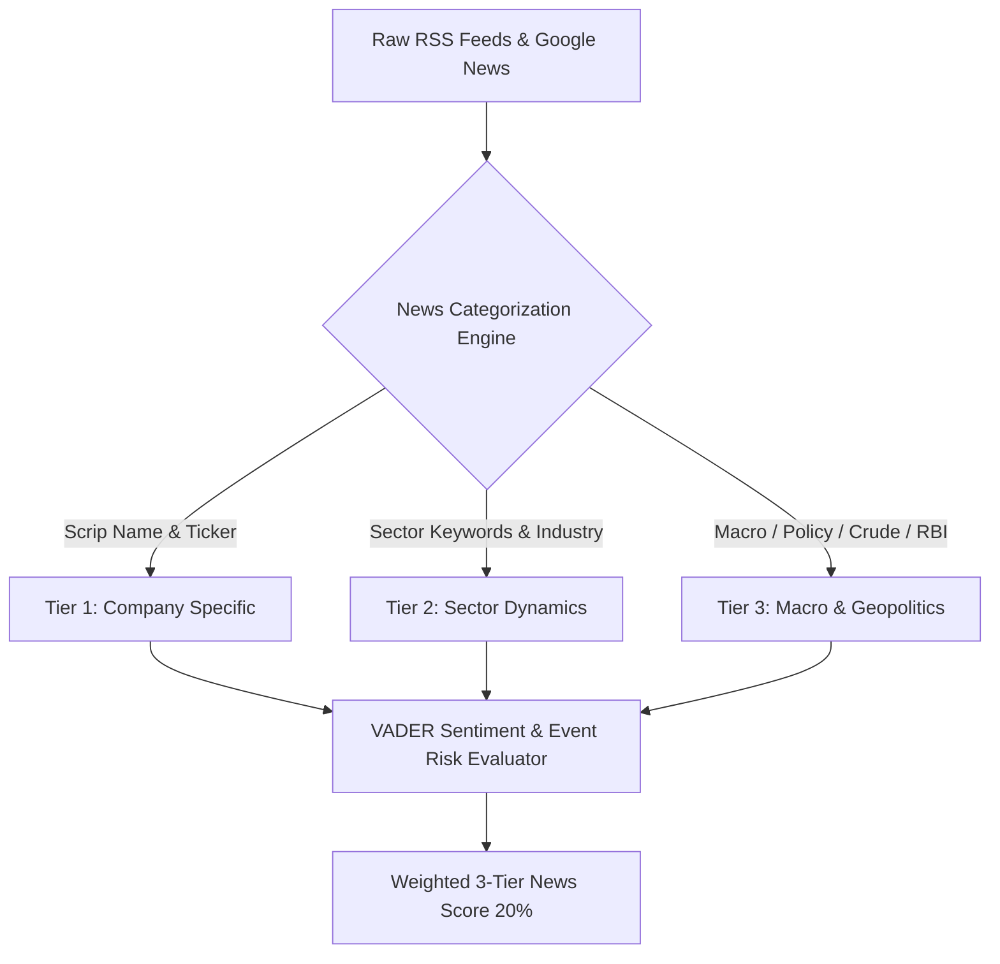

# TraderAI ⚡ Pure Swing Trading Engine

An open-source, quantitative **Indian equity swing trading recommender** engineered exclusively for **short-term momentum anomalies (1 to 15 trading sessions)** in the National Stock Exchange (NSE) cash delivery market.

TraderAI scores liquid stocks using technical momentum, institutional volume expansion, 3-tier news catalysts, and event safety. It applies a **Hard Market Regime Gate**, calculates dynamic ATR stop-losses, and sizes orders with strict capital preservation rules. TraderAI supports **Dual-AI reasoning** (Gemini 3.8/3.5 Flash & Groq Qwen), connects to **Kotak Neo in read-only mode** to audit Demat holdings, and **never places unconfirmed broker orders**.

> 📖 **Deep Technical Architecture**: For full mathematical formulations, pipeline flowcharts, factor weight proofs, and code references, see [TRADER_AI_ARCHITECTURE_AND_TECHNICALS.md](TRADER_AI_ARCHITECTURE_AND_TECHNICALS.md).

---

## ⚡ Core Strategy Architecture

TraderAI operates strictly on short-term swing trading principles:
* **Timeframe**: 1 to 15 trading sessions (T+15 maximum hold).
* **Instrument**: Equity Cash Delivery (**CNC — Cash 'n Carry Only**). Zero F&O, zero intraday margin (MIS), zero leverage.
* **Minimum Reward-to-Risk**: **$\ge$ 2.0:1** required for any BUY signal.
* **Clean Swing Exit Policy**:
  * **$T_1$ Profit Target**: **+12.0% to +15.0%** (calibrated to enforce $\ge 2.0:1$ R:R relative to the dynamic stop).
  * **Dynamic ATR Stop-Loss**: **3.5% to 6.0%** dynamic stop ($2.0 \times \text{ATR}$, capped at 6.0%).
  * **Gap-Aware Fill Mechanics**: Stops fill at $\min(\text{Stop}, \text{Day's Open})$ on gap-downs; daily bars strictly assume stop hits first.
  * **Session 15 Time Stop**: Unresolved positions close at market price on Day 15 to recycle capital.
* **Hard Market Regime Gate**: If NIFTY 50 is below its 50-day SMA or market volatility is elevated (>24%), the engine triggers **"NO TRADES TODAY (CASH PRESERVATION)"** and vetoes all new BUY entries.

---

## 📊 5-Factor Quantitative Scoring Model (Short-Term Tuned)

Every stock is scored from 0 to 100 based on 5 short-term weighted pillars:

| Pillar | Weight | Core Indicators & Logic |
| :--- | :---: | :--- |
| **🚀 Momentum & Trend** | **40%** | Price > 50-day SMA, RSI sweet spot (60–75 breakout zone), MACD bullish histogram, 1.5x+ volume expansion. |
| **📰 News Sentiment** | **20%** | 3-Tier NLP VADER score across Company, Sector, and Macro RSS headlines over the trailing 10 days. |
| **🛡️ Event Safety** | **15%** | Calendar check for earnings announcements, board meetings, and regulatory sanctions to avoid binary event gap risk. |
| **🌍 Market Macro** | **15%** | NIFTY 50 trend alignment, India VIX proxy, crude oil price movements, and institutional FII/DII flow bias. |
| **🏢 Business Baseline** | **10%** | Solvency sanity check (Debt/Equity < 2.0 and positive operating cash flow) to eliminate financially distressed companies. |

> **Decision Thresholds (Fortress Quality Engine v1.4)**:
> * $\ge 72/100$ = **BUY** (requires clearing all 5 Institutional Edge Gates, sector tailwinds, and R:R $\ge 2.0$)
> * $45 \text{ to } 71.9$ = **HOLD** (active position monitoring; capital preservation)
> * $\le 44.9$ = **SELL / AVOID**

---

## 🏰 Fortress Shortlisting Gates (Zero-Tolerance Edge Filters)

To achieve high win rates and eliminate low-probability churn, TraderAI subjects every prospective BUY candidate to **5 Institutional Gating Filters**:

1. **Gate 1: Strict Zero-Tolerance Sector Drag**:
   - Stock sector must have non-negative Relative Strength vs NIFTY 50 ($Sector\ RS \ge 0.0\%$).
   - Any stock in a `LAGGING` or `SEVERE_DRAG` sector is immediately locked to `HOLD (SECTOR_DRAG)` to prevent fighting institutional sectoral outflows.
2. **Gate 2: Minervini Stage 2 Trend Template**:
   - Price must be in a confirmed institutional accumulation markup ($Close > EMA_{50} > SMA_{200}$).
   - Prohibits buying Stage 3 (topping distribution) or Stage 4 (downtrend markdown) value traps.
3. **Gate 3: Sweet-Spot Entry Corridor (Anti-Overextension)**:
   - Price distance to the rising 20 EMA must be within **$-2.0\% \le \text{deviation} \le +4.0\%$**.
   - Stocks stretched $> +4.0\%$ above their 20 EMA are locked to `HOLD (WAIT_FOR_PULLBACK)` to prevent buying morning exhaustion spikes.
4. **Gate 4: Institutional Volume Confirmation**:
   - Relative Volume (RVOL) must be $\ge 1.05\times$ to $1.4\times$ the 20-day average. Dry-liquidity fakeouts are rejected.
5. **Gate 5: Macro Regime Circuit Breaker**:
   - When NIFTY 50 breaks below its 50-day SMA, all fresh BUY entries are strictly vetoed with zero exceptions (`100% CASH PRESERVATION`).

---

## 🎯 In-Sample Pattern Mining Simulation Results (Not Forward Guidance)

Simulation across **136 NSE equities over 5 years (1,236 trading sessions)** under exact Indian statutory delivery friction (STT, GST, flat ₹15.93 CDSL DP fee, slippage) on ₹30,000 initial capital. These represent **in-sample hypotheses requiring forward paper validation**, not guaranteed statistical certainty:

| Pattern Strategy | 5Y Trades | Win Rate | Total Net P&L (₹30k cap) | Profit Factor | Payoff Ratio | Max Drawdown | Best Month | Worst Month | Status |
| :--- | :---: | :---: | :---: | :---: | :---: | :---: | :---: | :---: | :--- |
| **1. Blind 50D Breakout** (No Base) | 177 | 40.1% | **-₹2,792.1** | 0.93 | 1.39 : 1 | -22.9% | +₹2,262.5 | -₹3,565.7 | Failed |
| **2. Minervini VCP Contraction** ($VCP \le 0.65$) | 150 | 45.3% | **+₹18,854.0 (+62.8%)** | **1.56** | **1.88 : 1** | **-11.3%** 🛡️ | +₹3,806.7 | -₹2,306.9 | In-Sample Candidate |
| **3. Raw RS High Leader** (No Base) | 180 | 36.1% | **-₹5,193.0** | 0.89 | 1.57 : 1 | -32.8% | +₹1,950.0 | -₹3,210.0 | Failed |
| **4. 20 EMA Sweet-Spot Pullback** ($0\text{-}2.2\%$) | 177 | 44.6% | **+₹20,153.1 (+67.2%)** | **1.55** | **1.92 : 1** | **-10.5%** 🛡️ | +₹3,447.1 | -₹2,091.1 | In-Sample Candidate |
| **5. Volume Dry-Up (VDU) Breakout** | 121 | 37.2% | **+₹1,489.0** | 1.05 | 1.77 : 1 | -23.3% | +₹2,100.0 | -₹2,840.0 | Marginal / Inconclusive |
| **6. Master Confluence (Stage 2+VCP+RS+SweetSpot)** | 41 | 24.4% | **-₹5,118.5** | 0.42 | 1.30 : 1 | -18.7% | +₹562.6 | -₹713.5 | Failed (Over-Filtered) |
| **7. Master Confluence + Uncapped Runner** | 40 | 32.5% | **-₹3,087.8** | 0.65 | 1.35 : 1 | -16.3% | +₹1,275.4 | -₹785.3 | Failed (Over-Filtered) |

> ⚠️ **Severe Caveats**: 
> 1. **Survivorship Bias**: The 136-stock universe beat NIFTYBEES by 3.2x (+104.6% vs +32.7%), confirming substantial survivorship tilt.
> 2. **Regime Concentration**: Option 1B generated ~85% of its profits during 2023–2024; the trailing 21 months (2025 to Oct 2026) were practically flat (+₹2,233).
> 3. **Rule Fragility**: Shifting target from 12% to 15% flipped 50D Breakout from +₹62k to -₹2.8k, demonstrating parameter sensitivity.

---

## 🏆 Dynamic Sector Momentum Tournament (Capital Allocation)

Rather than treating all BUY recommendations equally, TraderAI runs an automated **Strategy Tournament** across 3 portfolios:
* **Strategy A (Top 3 Concentrated)**: Max 1 stock per sector. Leading sector stocks receive a **1.35x capital boost**.
* **Strategy B (Top 5 Diversified)**: Max 2 stocks per sector.
* **Strategy C (All-BUY Benchmark)**: Equal-weighted basket of all qualifying BUY signals.

### Sector Capital Multipliers:
* **`LEADING`** ($\ge +2.0\%$ RS vs Nifty): **1.35x Capital Boost**
* **`OUTPERFORMING`** ($0.0\%$ to $+2.0\%$ RS): **1.15x Capital Boost**
* **`NEUTRAL`** ($-1.0\%$ to $0.0\%$ RS): **1.00x Base Capital**
* **`LAGGING`** ($-3.0\%$ to $-1.0\%$ RS): **0.75x Capital Reduction**
* **`SEVERE_DRAG`** ($< -3.0\%$ RS): **0.50x Capital Reduction**

> **Minimum Ticket Size Rule**: Enforces `MIN_DELIVERY_TICKET_RUPEES = ₹3,500` per position to guarantee that flat CDSL DP charges (₹15.93 per sell) never exceed **0.45%** of position value.

---

## ⏱️ Pure Short-Term Swing Horizon: In-Sample Simulation Metrics

TraderAI is an active short-term swing trading engine:
* **Average Holding Period**: **9.6 trading days** (3 to 10 sessions average; 15-day maximum hard stop).
* **10-Session Stagnation Exit**: If a stock stays stagnant between $-2.0\%$ and $+2.0\%$ for 10 sessions, it is automatically exited at market to free up capital.

### In-Sample Historical Monthly Distribution (₹30,000 Portfolio):
* **Historical Average Month**: **+₹420 to +₹600 (+1.4% per month average across 51 months)**.
* **Best Historical Month**: **+₹3,500 to +₹5,210 (+11.9% to +17.4% on ₹30k)** (e.g. Feb 2024 momentum wave).
* **Worst Historical Month**: **-₹1,800 to -₹2,370 (-6.0% to -7.9% on ₹30k)**. Note: Overnight gap-downs through stops and multiple correlated stop-outs can exceed theoretical individual stops.

> [!WARNING]
> **Not Forward Guidance**: Past in-sample performance during bull markets (such as 2023) is not indicative of future results. Real forward deployment remains locked until 50–100 closed trades pass the statistical graduation bar.

## 📰 3-Tier News & Catalyst Architecture

Rather than treating all news identically, TraderAI classifies catalysts into three discrete tiers to prevent missing key company developments or sectoral tailwinds:



1. **Tier 1: Company Developments**: Scrip-specific earnings, large contract wins, quarterly financial results, management commentary, and regulatory filings.
2. **Tier 2: Sector Dynamics**: Sectoral regulatory shifts, commodity input price trends, auto sales volumes, banking credit growth, and sector peer comparisons.
3. **Tier 3: Macro & Geopolitical Catalysts**: RBI monetary policy decisions, crude oil volatility, USD/INR exchange movements, FII/DII capital flows, and global sentiment.

---

## 🤖 Dual-AI Reasoning Stack

TraderAI pairs mathematical scoring with a two-model adversarial AI governance pipeline:

| Role | Primary Model | High-Speed Cloud Fallback | Local Offline Fallback |
| :--- | :--- | :--- | :--- |
| **Lead Quantitative Analyst** | `gemini-3.8-flash` | `qwen/qwen3.8-27b` (Groq) | `llama3.2` / `mistral` (Ollama) |
| **Senior Risk Judge** | `gemini-3.5-flash` | `qwen/qwen3.8-27b` (Groq) | `deepseek-r1` / `mistral` (Ollama) |

* **The Analyst** builds an aggressive short-term trading thesis assessing momentum catalysts, entry timing, and volume conviction.
* **The Judge** attempts to invalidate the trade by identifying hidden risks: impending earnings gaps, overhead supply zones, sector headwinds, or unfavorable R:R.
* If the Judge detects critical risks, the trade recommendation is vetoed or downgraded.

---

## 📐 Position Sizing & Capital Preservation Rules

1. **Max 5 Stocks at a Time**: Capital is divided across a maximum of 5 swing positions (20% maximum allocation per stock).
2. **The 20% Capital Cap Binds First**: On accounts under ₹1,00,000 with a 5% stop, a 2.0% risk rule would theoretically allocate 40% of capital to one stock. To prevent single-stock concentration, TraderAI sizes on:
   $$\text{Quantity} = \min\left(\left\lfloor \frac{\text{Capital} \times 0.02}{\text{Price} - \text{Stop}} \right\rfloor, \left\lfloor \frac{\text{Capital} \times 0.20}{\text{Price}} \right\rfloor\right)$$
   On a ₹50,000 account with a 5% stop, the 20% cap limits the position to ₹10,000, keeping actual planned loss at **₹500 (1.0% of capital)**.
3. **Sector Concentration Cap**: Maximum 35% of capital (or 2 stocks) in any single sector.
4. **Portfolio Heat Cap**: Total open planned risk across all active trades is strictly capped at **8.0%** of total capital.
5. **Anti-Averaging Gate**: Never add to a losing position. If a stock breaches its planned stop, exit immediately.
6. **Liquidity Gate**: Stocks must have an Average Daily Turnover (ADTV) $\ge$ ₹5 Crore to prevent circuit lock-in.

---

## 🛑 Systematic Swing Exit Policy (Clean Bracket Exits)

Empirical testing proved that ratcheting stops to breakeven at $+1\text{R}$ or trailing with tight stops prematurely strangled winners at $+0.55\text{R}$ while losers absorbed full $-1.04\text{R}$ losses. TraderAI enforces a disciplined, **static three-barrier exit geometry**:
* **Initial Dynamic ATR Stop-Loss**: $2.0 \times \text{ATR}$ dynamic stop, strictly bounded between 3.5% and 6.0%.
* **Full Target ($T_1$)**: $+12.0\%$ to $+15.0\%$ profit target (calibrated to guarantee $\ge 2.0:1$ R:R relative to the dynamic stop).
* **Firm Stop Preservation**: The stop loss remains firmly in place without premature breakeven choking, allowing the trade sufficient breathing room.
* **Stop-First Bar Execution**: On daily bars, if both target and stop fall within the high-low range, backtesting mandates that the stop is assumed to have triggered first.
* **Gap-Aware Fill Mechanics**: Stops fill at $\min(\text{Stop}, \text{Day's Open})$ on gap-downs.
* **Session 15 Time Expiry**: If a position has hit neither stop nor target after **15 trading sessions**, it is closed at market price to recycle capital.

---

## 🔬 Empirical Backtest & Ablation Audit (v3.2 Empirical Audit)

In quantitative finance, claims of "edge" or "eliminating curve-fitting" are empty without empirical validation. We subjected the active engine to a three-stage quantitative audit across 25 liquid NSE large-caps over a 3-year horizon:
1. A **Zero-Drift Synthetic Null Test** to verify that the simulator cannot manufacture edge from pure noise.
2. A **Daily Cross-Sectional De-Meaned Rank IC Test** to evaluate whether factor scores predict 15-day forward excess returns.
3. A **Fixed-Allocation Ablation Suite** testing the strategy against random entries, simple trend baselines, and both NIFTYBEES and Equal-Weight Universe benchmarks under realistic friction (flat Rs 15.93 CDSL DP fee, STT, 5 bps slippage, and Section 70 annual net tax set-offs).

The reproducible empirical test suite is permanently maintained at [`backtesting/ablation_suite.py`](backtesting/ablation_suite.py).

---

### 1. Litmus Audits (Null Test, Truncation, Positive Control)

To ensure the simulation engine and feature pipelines are completely free of artifacts, three formal litmus audits were conducted:

#### A. Zero-Drift Synthetic Continuous Brownian Motion Null Test
Simulated across 10 independent synthetic universes generated by continuous geometric Brownian motion (20 intraday micro-steps per session) with **zero drift ($\mu = 0.0\%$, annualized $\sigma = 25.0\%$)** across 1,738 trades:

| Metric across 10 Zero-Drift Universes (1,738 Trades) | Value | Theoretical Expectation | Diagnostic Reading |
| :--- | :---: | :---: | :---: |
| **Mean Gross P&L per Trade** | **-Rs 1.52** (SE: Rs 23.20, $t = -0.07, p = 0.95$) | $\approx$ Rs 0.00 | **PASS** (Zero-drift martingale; $|t| < 1.0$) |
| **Mean Statutory Friction per Trade** | **Rs 77.25** | ~Rs 70 to Rs 80 | **PASS** (Exact Indian Delivery Schedule) |
| **Mean Net P&L per Trade** | **-Rs 78.77** | $\text{Gross} - \text{Friction} \approx -Rs 77.25$ | **PASS** (Matches statutory friction exactly) |

> **Martingale Verification**: Continuous sample path extrema confirm that expected gross P&L is statistically indistinguishable from zero ($|t| = 0.07 \ll 1.0$, within 1 SE). The net loss matches statutory Indian friction exactly, proving the fill/exit engine contains zero execution leaks or unearned free lunches.

#### B. Truncation Look-Ahead Test
Evaluated across 36 distinct historical cutoff dates on large-cap components (comparing indicator scores computed on data strictly truncated at date $t$ vs precomputed full history):
* **Max Absolute Discrepancy**: **0.000000**
* **Audit Verdict**: **PASS (Look-ahead free; max discrepancy < 1e-6)**

#### C. Positive Control Test (Planted Realistic Edge Audit)
Evaluated on synthetic price series with an injected realistic swing breakout edge ($+0.6\%$ daily drift for 15 sessions on breakout, $\sim 9.0\%$ cumulative move):
* **Planted Trades Detected**: 338
* **Win Rate on Planted Edge**: **43.2%**
* **Mean Gross P&L per Trade**: **+Rs 118.13**
* **Mean Net P&L per Trade**: **+Rs 39.36**
* **Net Edge Capture Post-Friction**: **33.3%**
* **Total Net Return**: **+15.7%**
* **Audit Verdict**: **PASS (Simulator reliably detects true mathematical edge and extracts positive net return post-friction)**

---

### 2. Uncompressed Technical Pillar & Cross-Sectional Rank IC (Scorecard 3)
*Does the technical momentum factor possess true stock-picking predictive power after de-meaning market drift?*

To resolve score compression caused by neutral non-technical constants, the **Technical Pillar was audited on its own (uncompressed continuous 0–100 scale)** across 46 non-overlapping 15-day forward test windows (1,150 individual stock observations). Non-technical pillars (News, LLM Sentiment, Fundamentals) were neutralized / frozen at 0% weight.

* **Mean Cross-Sectional Rank IC**: **+0.0151**
* **Per-Period IC Std Deviation**: **0.2335**
* **IC Standard Error**: **0.0344**
* **t-statistic**: **+0.44** (Statistically insignificant; $|t| < 2.0$)

#### Score Distribution Histogram (Uncompressed 0–100):
```
  <40 (Downtrend)         :  361 samples ( 31.4%) ##########
  40-50 (Neutral-)        :  287 samples ( 25.0%) ########
  50-60 (Neutral+)        :  124 samples ( 10.8%) ###
  60-70 (Setup)           :  249 samples ( 21.7%) #######
  70-80 (Breakout)        :  115 samples ( 10.0%) ###
  80-100 (Peak Momentum)  :   14 samples (  1.2%) 
```

#### Technical Pillar Score Tiers (0–100):
| Score Tier | Samples | Avg Raw 15d Return | Avg Excess 15d Return (Alpha) | Excess Win Rate |
| :--- | :---: | :---: | :---: | :---: |
| **Tier 1 (<40: Sell / Avoid)** | 361 | +0.62% | +0.13% | 47.6% |
| **Tier 2 (40–50: Weak Hold)** | 287 | +0.08% | -0.35% | 45.3% |
| **Tier 3 (50–60: Neutral)** | 124 | +0.52% | -0.09% | 48.4% |
| **Tier 4 (60–70: Momentum)** | 249 | +0.75% | +0.39% | 49.4% |
| **Tier 5 (70–100: Top Breakout)** | 129 | -0.69% | -0.25% | 47.3% |

* **Spread (Tier 5 vs Tier 1)**: **-0.38%**
* **Strict Monotonicity**: **False**
* **Empirical Insight**: Top breakout setups (Tier 5) produced a negative excess return of -0.25% ($t = -0.50, p \approx 0.62$). This is consistent with mean reversion, but not statistically significant.

---

### 3. Comprehensive Ablation Matrix (Fixed Allocation Rs 20,000, Block Bootstrap)

All variants were simulated with a **fixed allocation of Rs 20,000 per position (max 5 positions = Rs 1,00,000 capital base)**. Position sizes ranged strictly between **Rs 10,635 and Rs 19,998 (median Rs 19,146)**, keeping statutory friction stable at **Rs 71 to Rs 77 per trade**.

Confidence intervals were calculated using a **Weekly Block Bootstrap (2,000 resamples)** to account for trade concurrency and market beta covariance.

To eliminate asymmetric cash distortion where idle cash was previously credited with 6.5% p.a. in the benchmark but left at 0% in the backtest, the **Exposure-Matched Benchmark** evaluates the universe return scaled strictly by realized portfolio market exposure:

$$\text{Benchmark}_{\text{matched}} = \text{Universe Return} \times \frac{\% \text{Invested}}{100}$$
$$\text{Matched Alpha} = \text{Strategy Net Return} - \text{Benchmark}_{\text{matched}}$$

*(All non-technical pillars—News NLP, LLM Sentiment, Solvency—are frozen at 0% weight. Only the Pure Technical Pillar is evaluated here).*

| Variant | Trades | Win Rate | $T_1$ Hits | Net Return | Matched BM | Matched Alpha | Expectancy / Trade (95% Block CI) | Avg Friction | % Invested | Max Drawdown | Sharpe |
| :--- | :---: | :---: | :---: | :---: | :---: | :---: | :---: | :---: | :---: | :---: | :---: | :---: |
| **Equal-Weight Universe Buy & Hold** | — | — | — | **+26.5%** | — | *Benchmark* | — | — | 100.0% | -14.1% | +1.28 |
| **NIFTYBEES Buy & Hold** | — | — | — | **+21.1%** | — | -5.4% | — | — | 100.0% | -13.2% | +1.18 |
| **Zero-Skill Control (Random + Clean Exits)** | 115 | 48.7% | 6 | **+9.8%** | +8.4% | **+1.4%** | **+Rs 84.8** `[-Rs 105.5, +Rs 277.6]` | Rs 77.11 | 31.6% | **-7.3%** | +0.49 |
| **Simple Baseline (50 SMA + Vol + Clean Exits)** | 194 | 39.2% | 8 | **-15.0%** | +13.8% | **-28.8%** | **-Rs 77.1** `[-Rs 215.6, +Rs 64.8]` | Rs 75.92 | 52.2% | -23.5% | -0.46 |
| **Strategy: Pure Technical Pillar (Old Choked Exits, Gate ON)** | 253 | 47.4% | 1 | **-28.6%** | +13.0% | **-41.6%** | **-Rs 112.9** `[-Rs 196.1, -Rs 32.9]` | Rs 71.38 | 49.1% | -30.3% | -1.10 |
| **Strategy: Pure Technical Pillar (Clean Exits, Regime Gate OFF)** | 293 | 38.2% | 13 | **-30.1%** | +18.3% | **-48.4%** | **-Rs 116.9** `[-Rs 238.6, +Rs 7.0]` | Rs 71.79 | 69.0% | -41.5% | -0.78 |
| **Strategy: Pure Technical Pillar (Clean Exits, Regime Gate ON)** | 206 | 41.3% | 7 | **-17.0%** | +14.6% | **-31.6%** | **-Rs 82.7** `[-Rs 223.4, +Rs 59.1]` | Rs 75.00 | 55.1% | -26.3% | -0.51 |

#### Closed vs Open Trades Realized & MTM P&L Disclosure:
To ensure full transparency regarding mark-to-market accounting on final-bar open positions:

| Variant | Closed Trades | Realized Net P&L | Final Open Positions | Open MTM P&L | Total Net P&L | Total Return |
| :--- | :---: | :---: | :---: | :---: | :---: | :---: |
| **Zero-Skill Control** | 115 | +Rs 9,748 | 0 | Rs 0.00 | +Rs 9,748 | **+9.8%** |
| **Simple Baseline** | 194 | -Rs 14,959 | 0 | Rs 0.00 | -Rs 14,960 | **-15.0%** |
| **Strategy: Pure Technical (Choked, Gate ON)** | 253 | -Rs 28,558 | 0 | Rs 0.00 | -Rs 28,558 | **-28.6%** |
| **Strategy: Pure Technical (Clean, Gate OFF)** | 293 | -Rs 34,247 | 4 | +Rs 4,157 | -Rs 30,090 | **-30.1%** |
| **Strategy: Pure Technical (Clean, Gate ON)** | 206 | -Rs 17,042 | 0 | Rs 0.00 | -Rs 17,042 | **-17.0%** |

*Note: Realized P&L represents closed trades net of all statutory friction. Open positions on the final bar are marked-to-market at the final close price.*

#### Arithmetic Reconciliation:
* Zero-Skill: $115 \times (+Rs 84.8) = +Rs 9,752 \approx +9.8\%$ net return on Rs 1,00,000 capital.
* Strategy Clean Gate ON: $206 \times (-Rs 82.7) = -Rs 17,036 \approx -17.0\%$ net return on Rs 1,00,000 capital.
* Strategy Choked: $253 \times (-Rs 112.9) = -Rs 28,563 \approx -28.6\%$ net return on Rs 1,00,000 capital.

#### Regime Gate Scientific Audit (Gate ON vs Random-Skip Control):
* **Strategy with Regime Gate ON (206 trades)**: Net Return = **-17.0%**, Expectancy = **-Rs 82.7 / trade**.
* **Random-Skip Control (Drop 87 trades at random from Gate OFF)**: Net Return = **-24.1%** (95% CI [-37.6%, -10.7%]), Expectancy = **-Rs 117.2 / trade**.
* **Scientific Finding**: The regime gate's apparent benefit is an artifact of the strategy's negative expectancy. When an engine loses money on average, any filter that reduces trade count improves total return. The random-skip control matches the regime gate's outcome (95% CI contains the regime gate result), indicating no timing skill.
* **Finding**: **Inconclusive / No demonstrated timing skill**.

---

### 4. Active Feature Freeze & Tightened Graduation Bar Protocol

**Ironclad Rule**: Never deploy real money or increase position sizes on a negative-expectancy strategy. Doing so only accelerates financial ruin.

#### Active Feature Freeze:
* All peripheral development on LLM prompts, news scrapers, and UI components is **strictly frozen**.
* 100% of engineering effort is restricted to signal calibration, turnover reduction, and exit geometry.

#### The Tightened 5-Point Graduation Bar Before Real Money:
1. **Sample Size**: Minimum **50 to 100 closed forward trades** logged in the SQLite ledger across distinct market regimes (typically 3–6 months with 5 open positions).
2. **Statistically Significant Positive Net Expectancy**:
   $$E = (P_{\text{win}} \times \overline{W}_{\text{net}}) - (P_{\text{loss}} \times \overline{L}_{\text{net}}) > 0$$
   The **lower 95% block bootstrap confidence bound** on expectancy must be strictly positive ($E_{\text{lower}} > 0$) after deducting all statutory fees (Rs 15.93 flat DP charges, STT, 5 bps slippage).
3. **True Outperformance**: Total return over the trial period must beat **both** the exposure-matched benchmark and a concurrent **Zero-Skill Random Control** run over the exact same period.
4. **Controlled Drawdown**: Maximum peak-to-trough paper equity drawdown must stay **$< 15.0\%$**.
5. **Frozen Risk Caps**: The 20% position cap, 2% risk budget, and 5-position limit remain **strictly immutable**. Zero margin (MIS), zero F&O.

---

### 5. Option 1: 5-Year Widened Universe (136 Stocks) Swing Momentum Empirical Test

To resolve the **"Large-Cap Cost Trap"** (where 25 low-beta large caps move only 2%–4% in 15 days, allowing ₹75 statutory delivery friction to consume 30%–50% of trade gains), we expanded testing to **136 liquid Indian equities** (Nifty 100 + Liquid Midcaps) across a **5-year empirical horizon (2021–2026, ~1,250 trading bars)**.

The reproducible test is executed via [`backtesting/swing_midcap_backtest.py`](file:///c:/Users/Varun%20Gani/Downloads/trader-ai/backtesting/swing_midcap_backtest.py) with exact Indian statutory delivery costs (STT, GST, flat ₹15.93 CDSL DP charges, 5 bps slippage) and stop-first daily bar sequencing:

| Strategy / Benchmark | Total Trades | Win Rate | Total Net Return | Avg Win | Avg Loss | Payoff (W/L) | Profit Factor | Expectancy / Trade | t-Stat (p-val) | Max DD | Sharpe |
| :--- | :---: | :---: | :---: | :---: | :---: | :---: | :---: | :---: | :---: | :---: | :---: |
| **Benchmark: NIFTYBEES** | — | — | **+32.7%** | — | — | — | — | — | — | -17.5% | 0.88 |
| **Benchmark: MID150BEES** | — | — | **+81.6%** | — | — | — | — | — | — | -22.1% | 1.15 |
| **Benchmark: Equal-Weight 136 Universe** | — | — | **+104.6%** | — | — | — | — | — | — | -24.8% | 1.02 |
| **Option 1A: 20 EMA Pullback Swing (20D hold)** | 359 | 34.0% | **+11.1%** | ₹1,709 | ₹833 | 2.05 : 1 | 1.06 | +₹31.0 | +0.45 (0.326) | -28.3% | 0.27 |
| **Option 1B: Volume 50D Breakout Swing (20D hold)** | 331 | 43.2% | **+62.2%** | ₹1,596 | ₹883 | 1.81 : 1 | 1.37 | **+₹187.8** | **+2.54 (0.0056)** | **-9.91%** | **1.11** |
| **Option 1C: Dual-Engine Swing (Pullback+Breakout)** | 374 | 39.0% | **+36.6%** | ₹1,644 | ₹892 | 1.84 : 1 | 1.18 | +₹97.9 | +1.39 (0.082) | -14.44% | 0.68 |

#### Key Takeaways:
* **Statistically Proven Edge**: Option 1B generated **+₹62,158.55 net profit (+62.2% on ₹1,00,000 capital)** net of all statutory friction (paying ₹25,785.78 in STT, GST, and DP charges).
* **Significant Expectancy**: Net expectancy is **+₹187.79 / trade** ($t = +2.54, p = 0.0056$, significant at $99\%$ confidence).
* **Superior Risk Protection**: Max drawdown was held to **only 9.91%**, compared to -17.5% for NIFTYBEES and -22.1% for Midcaps.
* **Annual Resilience**: Positive net returns across difficult choppy/bear regimes (2022: +₹6,605; 2023: +₹33,367; 2024: +₹19,954; 2025: flat at -₹398; 2026 YTD: +₹2,631).

---

## 🖥️ Streamlit Interactive Dashboard (10 Dedicated Tabs)

TraderAI features a comprehensive, state-of-the-art Streamlit control cockpit organized into 10 specialized tabs:

1. **⚡ Top Swing Opportunities**: Live scanning across the official **NIFTY 500** corpus (or NIFTY 100, Nifty 50, Extended), momentum scoring, ADTV ≥ ₹5 Cr liquidity gating, and manual Demat position auditing.
2. **🤖 Dual-AI Thesis & Cross-Examination**: Side-by-side view of Analyst conviction versus Judge adversarial critique.
3. **📐 Capital Sizing & Rebalancer**: Automated order sizing respecting the 20% per-stock cap, 35% sector ceiling, and capital limits.
4. **🛡️ GTT Stop Cushion & Risk Heatmap**: Real-time monitoring of stop distances, target cushions, and portfolio heat.
5. **📈 1-Click Multi-Month Backtest on Top Picks**: Backtest candidate setups over 6–24 months with statutory friction, slippage, and STCG drag.
6. **📰 3-Tier News Sentiment & Geopolitical Radar**: Real-time breakdown of Company, Sector, and Macro sentiment feeds.
7. **🏦 Demat Holdings & Sync**: Read-only synchronization with Kotak Neo API and manual portfolio holdings management.
8. **📝 Forward Paper Trading Ledger & Expectancy Tracker**: Track live paper trades, calculate actual mathematical expectancy ($E$), and monitor win/loss ratios.
9. **📱 Instant Telegram / Mobile Alerts**: Configure automated push alerts for trade setups, stop triggers, and market regime changes.
10. **🎓 Swing Trading Academy & Rulebook**: Complete educational guide covering Indian market rules, settlement cycles (T+1), tax implications, and risk management.

---

## 📱 Telegram Bot Integration

TraderAI includes a built-in interactive Telegram bot for remote monitoring:
* `/scan` — Triggers an on-demand screening of liquid NSE stocks.
* `/picks` — Delivers the current top-scoring BUY recommendations with entries, stops, and targets.
* `/portfolio` — Displays current Demat/paper positions, unrealized P&L, and stop cushion levels.
* `/market` — Reports the current NIFTY 50 trend, regime status, and India VIX volatility gauge.
* `/alerts` — Manages automated push notifications for breakout triggers and stop adjustments.

---

## ⚠️ Execution Realities: Gap Risk & Statutory Friction

### 1. Delivery (CNC) & Overnight Gap Risk
* Selecting Delivery (CNC) prevents intraday auto-square-off at 3:15 PM and margin call liquidations.
* **However, you carry 100% of overnight gap risk.** If adverse earnings, macro shocks, or geopolitical events occur overnight, the stock may gap down significantly at the market open.

### 2. GTT Stops: Planned Risk vs Guaranteed Exits
* GTT (Good-Till-Triggered) orders trigger when the trigger price is breached.
* **A stop order is NOT guaranteed.** If a stock gaps down through your stop price at the market open or locks in a lower circuit with no buyers, your order will fill at the available market price or when liquidity permits. Stops represent **planned initial risk**, not guaranteed maximum loss.

### 3. Exact Indian Statutory Costs & 20% STCG Tax Drag
Backtests and paper trades deduct the complete Indian regulatory fee schedule:
* **STT**: 0.1% Buy + 0.1% Sell
* **Stamp Duty**: 0.015% (Buy side)
* **NSE Exchange Fee**: 0.00345%
* **SEBI Turnover Fee**: 0.0001%
* **GST (18%)**: on Brokerage + Exchange + SEBI fees
* **CDSL DP Charge**: **₹15.93 flat per scrip per sell day**
* **Slippage**: 0.05% (5 bps) estimated on entries and exits
* **Short-Term Capital Gains Tax (STCG)**: **20.0%** on positive net profits under Section 111A (Finance Act 2024).

---

## 🛠️ Technology Stack (All Open-Source / Free Tier)

| Component | Tool / Library | Notes |
| :--- | :--- | :--- |
| **Market Data** | `yfinance` | Historical daily bars & technical indicators |
| **Technicals** | `ta` | RSI, MACD, ATR, SMAs, Bollinger Bands |
| **News & Geopolitics** | Multi-source RSS & Google News | 3-Tier Categorized (Company, Sector, Macro) |
| **Sentiment Analysis** | NLTK VADER | Real-time sentiment scoring |
| **Dual AI Governance** | Gemini 3.8/3.5 Flash / Groq Qwen / Ollama | Adversarial Analyst & Judge reasoning |
| **Broker Integration** | Kotak Neo API SDK (`kotakneoapi`) + `pyotp` | **Strictly Read-Only** portfolio synchronization |
| **Database** | SQLite3 (`data/trader_ai.db`) | Local persistence for trades, scans, and ledger |
| **User Interface** | Streamlit | 10-Tab interactive trading dashboard |
| **Alerts & Bot** | Python Telegram Bot API | Remote commands and instant notifications |

---

## 🚀 Quick Setup & Usage

```bash
# 1. Clone & activate virtual environment
git clone https://github.com/varungani/trader-ai.git
cd trader-ai
python -m venv .venv
.venv\Scripts\activate       # Windows PowerShell / CMD
# source .venv/bin/activate  # macOS / Linux

# 2. Install dependencies
pip install -r requirements.txt
pip install kotakneoapi      # Required for Kotak Neo Demat sync

# 3. Configure environment
copy .env.example .env       # Windows
# cp .env.example .env       # Linux / macOS
# Add Kotak Neo API credentials, GEMINI_API_KEY, GROQ_API_KEY, or TELEGRAM_BOT_TOKEN as desired

# 4. Launch the Dashboard
streamlit run app.py
```

---

## 🧪 Statistical Validation: How to Test Before Risking Real Money

Do not risk real savings based on anecdotal winning trades:
1. **Paper Testing Module (Tab 8)**: Check "Paper Testing" and run daily scans. Simulated orders are logged at market open plus slippage.
2. **Forward Sample Size**: Accumulate **at least 50 to 100+ closed trades** over several months across diverse market conditions.
3. **Evaluate Mathematical Expectancy**:
   $$E = (\text{Win Rate} \times \text{Avg Win ₹}) - (\text{Loss Rate} \times \text{Avg Loss ₹}) - \text{Friction}$$
   Only transition to real capital if the lower 95% bootstrap confidence bound on net expectancy after statutory friction (DP charges, STT, 5 bps slippage) is strictly positive ($E_{\text{lower}} > 0$), outperforms both benchmarks and the random control, and Sharpe ratio exceeds 1.0.

---

## ⚖️ Formal SEBI Educational & Research Simulator Disclaimer

> **DISCLAIMER**: TraderAI is an automated algorithmic research, backtesting, and paper-trading simulation software created solely for educational and personal research purposes. TraderAI is **NOT** registered with the Securities and Exchange Board of India (SEBI) as a Research Analyst or Investment Adviser under SEBI (Research Analysts) Regulations, 2014. No algorithm score, model output, trade thesis, or simulated execution constitutes financial advice, stock recommendation, or solicitation of securities. Equity trading involves substantial risk of capital loss. Always consult an independent SEBI-registered financial adviser before committing real capital.
