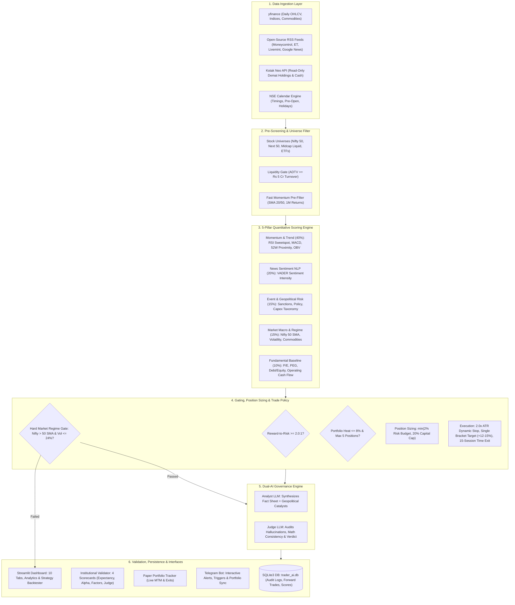
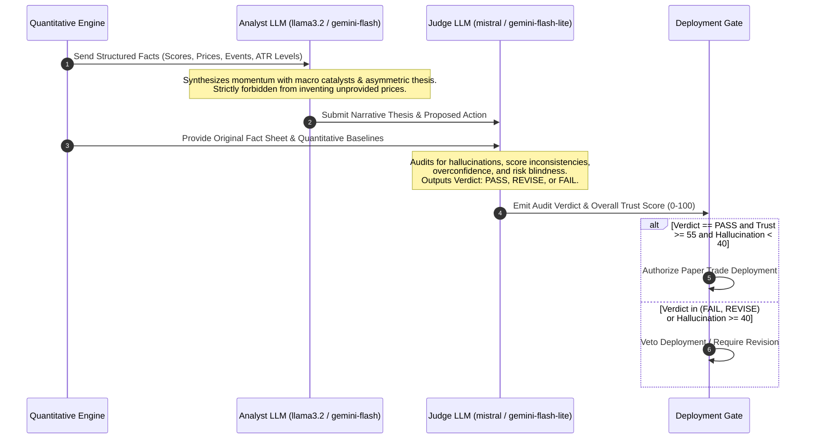
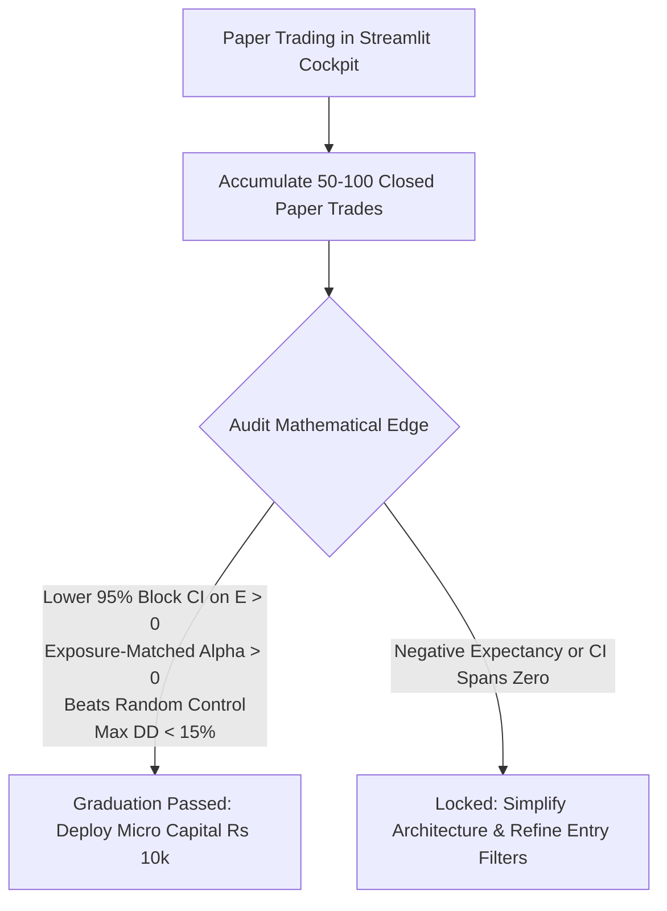
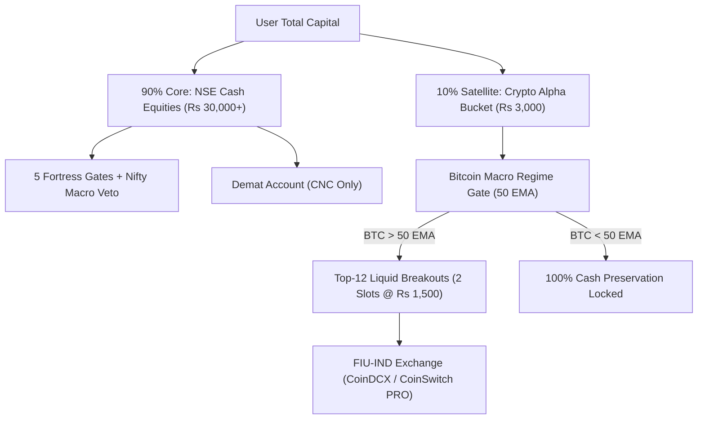

# TraderAI ⚡ System Architecture & In-Depth Technical Specification

> **Document Version:** 2.3.0-empirical-audit  
> **Status:** Experimental Simulator & Quantitative Research Specification  
> **Focus:** Short-Term Indian Equity Swing Trading Engine (1 to 15 Sessions)  
> **Instrument:** NSE Cash Delivery (CNC — Cash 'n Carry Only)  
> **Broker Integration:** Kotak Neo API SDK (Strictly Read-Only Holding & Balance Audit)  
> **Compliance:** SEBI (Research Analysts) Regulations, 2014 Educational/Simulator Framework

---

## 1. Executive Summary & Core Philosophy
 
**TraderAI** is an open-source, quantitative research and simulation engine engineered for empirical testing of short-term swing trading anomalies (1 to 15 trading sessions) in the National Stock Exchange of India (NSE) cash delivery market. It analyzes momentum setups, evaluates multi-factor signals, enforces strict capital preservation rules, and subjects all hypotheses to empirical backtesting and out-of-sample scrutiny.

### Guiding Principles

1. **Pure Swing Trading Focus (CNC Only)**:
   - Zero Futures & Options (F&O).
   - Zero Intraday Margin (MIS) or leveraged day trading.
   - Eliminates broker auto-square-off at 3:15 PM and margin call liquidations.
   - Explicitly accounts for 100% overnight gap risk and circuit limits.

2. **Hard Market Regime Gating (Cash Preservation)**:
   - When the underlying benchmark (**NIFTY 50**) is below its 50-day Simple Moving Average (SMA) or market volatility is elevated (>24% annualized proxy), the engine vetoes all new long entries (`NO TRADES TODAY — CASH PRESERVATION`).

3. **Asymmetric Risk-to-Reward ($\ge 2.0:1$)**:
   - No trade recommendation is generated unless planned upside target is at least twice the planned downside risk ($Reward : Risk \ge 2.0$).
   - Dynamic stop-losses ($2.0 \times \text{ATR}$, bounded between 3.5% and 6.0%) adapt to each stock's volatility.

4. **Dual-AI Governance (Analyst vs. Independent Judge)**:
   - Two distinct LLM instances (local Ollama `llama3.2` + `mistral`, or cloud Gemini/Groq/OpenAI).
   - The **Analyst** synthesizes multi-factor scores with macro/geopolitical news.
   - The **Judge** acts as an independent risk auditor, checking every claim against factual data to detect hallucinations, verify math, and hold a hard veto over simulated order deployments.

5. **Read-Only Broker Integration**:
   - Interacts with **Kotak Neo API** using TOTP (`pyotp`) strictly to audit Demat holdings, current market value, and cash reserves.
   - **Never places automated broker orders.** All executions remain under human discretion via broker GTT (Good-Till-Triggered) OCO orders.

6. **Full Statutory Tax & Regulatory Friction Accounting**:
   - Accounts for all Indian statutory fees: STT, Stamp Duty, NSE Exchange Charges, SEBI Turnover Fee, GST (18%), CDSL DP charges (flat ₹15.93 per scrip per sell day), 5 bps slippage, and **20% Short-Term Capital Gains Tax (STCG)** under Section 111A (Finance Act 2024).

---

## 2. High-Level System Architecture

The following diagram illustrates the end-to-end data flow and architectural topology:



---

## 3. Directory Layout & Module Breakdown

| Directory / File | Lines of Code | Technical Purpose & Responsibility |
| :--- | :---: | :--- |
| `config.py` | 443 | Central environment variables, risk constants, universe tickers, RSS feeds, event keyword taxonomy, model configurations. |
| `app.py` | 1,069 | High-performance Streamlit dashboard featuring 10 analytical tabs, real-time metrics, interactive GTT trackers, and visual backtesting. |
| `run.py` | 167 | CLI entry point supporting scheduled scans, paper testing automation, headless execution, and JSON outputs. |
| **`engine/`** | | **Core Strategy & Decision Architecture** |
| `engine/pipeline.py` | 409 | End-to-end orchestration pipeline connecting data fetching, scoring, risk gating, LLM review, and database snapshotting. |
| `engine/trade_policy.py` | 243 | **Single Source of Truth** for trade levels, dynamic ATR stops, clean target levels, and 15-day time exit resolution. |
| `engine/recommender.py` | 231 | Score-to-action mapper (`BUY`, `HOLD`, `SELL`, `TRIM`, `AVOID`) with portfolio risk gating and stop-loss logic. |
| `engine/validator.py` | 343 | Institutional forward validation engine generating the 4 mathematical scorecards on out-of-sample data. |
| `engine/balancer.py` | 565 | Capital allocation balancer, 20% single-stock cap enforcement, risk budget calculation, and portfolio heat monitoring. |
| `engine/screener.py` | 212 | Fast pre-screener filtering universes (~150 names) down to top candidates for deep multi-factor scoring. |
| `engine/scorer.py` | 210 | 5-pillar composite scoring engine combining technical, fundamental, sentiment, macro, and event scores. |
| `engine/llm_review.py` | 134 | Pipeline wrapper connecting the Analyst and Judge LLMs to candidate recommendations. |
| `engine/paper_week.py` | 338 | Weekly simulated paper trading manager; handles simulated order fills, mark-to-market updates, and trust gating. |
| `engine/monthly_plan.py` | 223 | Monthly capital growth planner balancing fresh equity deployment with defensive asset allocation. |
| **`analysis/`** | | **5-Factor Quantitative Analytical Modules** |
| `analysis/technical.py` | 290 | Indicators (RSI sweet spot, MACD histogram %, 52W proximity, Bollinger band walks, ATR %, OBV, ADTV turnover). |
| `analysis/macro.py` | 218 | Macro market trend (Nifty 50 50-day SMA, annualized volatility proxy, crude oil, gold, institutional FII/DII proxy). |
| `analysis/sentiment.py` | 168 | NLP sentiment scoring engine using NLTK VADER compound polarity across company and sector news. |
| `analysis/event_risk.py` | 147 | Event taxonomy engine scanning for sanctions, regulatory penalties, capex awards, defence deals, and management risk. |
| `analysis/fundamental.py` | 235 | Solvency sanity checker evaluating P/E, PEG, Debt/Equity, Current Ratio, Operating Cash Flow, and ROE. |
| **`data/`** | | **Data Infrastructure & Broker Connectivity** |
| `data/costs.py` | 136 | Complete statutory friction calculator: STT, Stamp Duty, NSE fees, SEBI fee, GST (18%), CDSL DP charges, slippage, 20% STCG. |
| `data/db.py` | 484 | SQLite persistence layer (`trader_ai.db`) for daily scores, paper trades, forward trade logs, and historical backtests. |
| `data/market_data.py` | 196 | Historical OHLCV, live market quotes, index data, and commodity feeds via `yfinance` caching. |
| `data/market_calendar.py` | 316 | Live NSE market clock, pre-open session detector, weekend/holiday calendar, and holiday countdowns. |
| `data/broker.py` | 288 | Kotak Neo API SDK integration supporting automated TOTP via `pyotp` for non-interactive holding and margin synchronization. |
| `data/news_data.py` | 184 | Multi-source headline aggregation with Yahoo Finance and Finnhub fallback handlers. |
| `data/news_oss.py` | 237 | High-speed RSS scraper parsing Moneycontrol, Economic Times, Livemint, and Google News RSS feeds. |
| `data/mutual_fund_data.py` | 129 | AMFI scheme data fetcher for tracking index mutual fund Net Asset Values (NAV). |
| **`llm/`** | | **Dual-AI Governance & Hallucination Prevention** |
| `llm/client.py` | 277 | Resilient multi-backend connector (Ollama, Gemini, Groq, OpenAI) with JSON extraction and role routing. |
| `llm/analyst.py` | 179 | Fact-constrained research assistant synthesizing momentum with outer-world catalysts and asymmetric setups. |
| `llm/judge.py` | 224 | Skeptical risk auditor identifying unsupported factual claims, mathematical inconsistencies, and overconfidence. |
| **`bot/`** | | **Interactive Telegram Bot & Real-Time Alerts** |
| `bot/telegram_bot.py` | 354 | Interactive Telegram bot with commands (`/portfolio`, `/alerts`, `/picks`, `/scan`, `/market`) and trailing stop alerts. |
| **`backtesting/`** | | **Historical Strategy Simulation** |
| `backtesting/engine.py` | 358 | Vectorized and event-driven historical backtester simulating dynamic ATR exits, trend filters, and statutory friction. |
| **`portfolio/`** | | **Portfolio State Management** |
| `portfolio/manager.py` | 243 | Local JSON portfolio persistence, holding updates, P&L calculations, and Kotak Neo reconciliation. |
| **`ui/`** | | **Visual Components & Educational Resources** |
| `ui/glossary.py` | 741 | 100+ comprehensive quantitative trading terms, statutory explanations, and strategy tutorials rendered in Streamlit. |

---

## 4. The 5-Pillar Quantitative Scoring Engine

Every stock analyzed undergoes evaluation across 5 quantitative pillars, resulting in a **Final Score (0 to 100)**:

$$\text{Final Score} = 0.40 \times S_{\text{Technical}} + 0.20 \times S_{\text{Sentiment}} + 0.15 \times S_{\text{Event}} + 0.15 \times S_{\text{Macro}} + 0.10 \times S_{\text{Fundamental}}$$

```
+-----------------------------------------------------------------------------------+
|                            5-PILLAR QUANTITATIVE MODEL                            |
+--------------------------+--------+-----------------------------------------------+
| Pillar                   | Weight | Core Evaluation Metrics                       |
+--------------------------+--------+-----------------------------------------------+
| 🚀 Momentum & Trend      |  40%   | 50/200 SMA trend alignment, RSI sweet spot    |
|                          |        | (60-75), normalized MACD histogram %, 52W    |
|                          |        | proximity (<=15%), Bollinger band walk, OBV.  |
| 📰 News Sentiment        |  20%   | NLTK VADER compound polarity across trailing  |
|                          |        | 10 days of verified company & sector news.   |
| 🛡️ Event Safety          |  15%   | Keyword taxonomy scanning for sanctions,     |
|                          |        | regulatory probes, capex wins, defence orders.|
| 🌍 Market Macro          |  15%   | NIFTY 50 50-day SMA, annualized volatility    |
|                          |        | proxy, Brent crude, gold inverse correlation. |
| 🏢 Business Baseline     |  10%   | Solvency filter: Debt/Equity < 2.0, positive  |
|                          |        | Operating Cash Flow, P/E & PEG valuation.     |
+--------------------------+--------+-----------------------------------------------+
```

### Action Mapping Thresholds (Harmonized with config.py & recommender.py)

* **Score $\ge 72.0$**: `BUY` / `STRONG_BUY` (Requires clearing all 5 Fortress Institutional Gates, sector tailwind, and R:R $\ge 2.0$).
* **Score $40.0 \text{ to } 71.9$**: `HOLD` (No clear statistical edge; active risk monitoring and capital preservation).
* **Score $\le 40.0$**: `SELL` (If held) or `AVOID` (If looking to enter).
* **Severe Event Override**: Any stock exhibiting binary disaster risk (SEBI probe, sanction, fraud, insolvency) is immediately forced to `SELL` / `AVOID`, regardless of high technical momentum.

---

## 5. Single Source of Truth: Trade Policy & Exit Execution

All trade exits across live recommendations (`recommender.py`), forward testing (`validator.py`), paper trading (`paper_week.py`), and historical backtesting (`backtesting/engine.py`) share a unified implementation in [`engine/trade_policy.py`](engine/trade_policy.py).

### 1. Dynamic ATR Stop-Loss
Rather than relying on arbitrary percentage stops, planned stop-losses adapt to stock volatility:
$$\text{ATR \%} = \frac{\text{ATR}_{14}}{\text{Price}} \times 100$$
$$\text{Planned Stop \%} = \min\left(6.0\%, \max\left(3.5\%, \text{ATR \%} \times 2.0\right)\right)$$

### 2. Clean Target & Breathing Room Geometry
Empirical testing revealed that premature $+1\text{R}$ breakeven ratchets and tight $1.5 \times \text{ATR}$ trailing stops choked 104 out of 265 winning trades at $+0.55\text{R}$ while losers absorbed full $-1.04\text{R}$ losses. The unified trade policy now enforces clean breathing room:
* **Base Target ($T_1$)**: $+12.0\%$ to $+15.0\%$ (calibrated to guarantee $\ge 2.0:1$ R:R relative to the dynamic stop).
* **Firm Stop Preservation**: The initial stop loss remains firmly in place until the trade reaches its target, preventing normal market volatility from prematurely triggering stops.
* **Stop-First Bar Resolution Rule**: On daily bars, if both the target price and the stop price fall within the day's high-low range, institutional backtesting conservatism mandates that the **stop is assumed to have triggered first**. Assuming target execution on ambiguous daily bars is prohibited as look-ahead bias.
* **Session 15 Time Expiry**: Swing trades are strictly short-term anomalies. If a position has hit neither stop nor target after **15 trading sessions**, it is closed at market price to recycle capital.
* **Realistic Gap-Down Fills**: Stops never fill at theoretical stop prices when a stock gaps down overnight:
  $$\text{Exit Fill Price} = \min(\text{Effective Stop}, \text{Day's Open})$$

---

## 6. Capital Allocation & Sizing Mathematics

TraderAI limits active exposure to a maximum of **5 focused swing positions** (20% maximum allocation per stock).

### Why the 20% Capital Cap Binds First

On retail accounts under ₹1,00,000 with a standard 5% stop, risking 2.0% of total capital on a trade would theoretically dictate allocating 40% of the account to a single stock ($2\% \div 5\% = 40\%$). To prevent single-stock concentration blowups, TraderAI enforces a dual-constraint sizing formula:

$$\text{Quantity} = \min\left(\left\lfloor \frac{\text{Capital} \times 0.02}{\text{Price} - \text{Stop}} \right\rfloor, \left\lfloor \frac{\text{Capital} \times 0.20}{\text{Price}} \right\rfloor\right)$$

#### Sizing Simulation Example (₹50,000 Account, ₹2,000 Stock, ₹1,900 Stop):
* Risk Budget Quantity: $(50000 \times 0.02) \div (2000 - 1900) = 1000 \div 100 = 10 \text{ shares}$ (₹20,000 = 40% of capital).
* Capital Cap Quantity: $(50000 \times 0.20) \div 2000 = 10000 \div 2000 = \mathbf{5 \text{ shares}}$.
* **Final Executed Order**: **5 shares** (₹10,000 invested).
* **Actual Planned Loss**: $5 \times ₹100 = \mathbf{₹500 \text{ (only 1.0\% of account capital)}}$.

### Additional Risk Boundaries

* **Sector Concentration Limit**: Maximum 35% of capital (or 2 stocks) in any single industry sector.
* **Portfolio Heat Cap**: The sum of all open planned risk across active positions cannot exceed **8.0%** of total capital.
* **Anti-Averaging Gate**: Adding to a losing position in drawdown is prohibited.
* **Liquidity Gate**: Stocks must trade an Average Daily Turnover (ADTV) $\ge$ ₹5 Crore to avoid circuit freezes.

---

## 7. Dual-AI Governance Architecture



### Prompt Guardrails & Separation of Concerns

1. **Analyst LLM (`llm/analyst.py`)**:
   - Synthesizes quantitative scores with real-world geopolitical and supply-chain themes (e.g., Make-in-India defense indigenization, PLI schemes, China+1 manufacturing, crude margin tailwinds).
   - Maps asymmetric upside and validates risk/reward parameters using dynamic ATR stops.
   - Constrained to cite explicit `fact_ids` from the input payload.

2. **Judge LLM (`llm/judge.py`)**:
   - Operates with an independent system prompt and preferably a different model architecture (e.g., Mistral auditing Llama, or Gemini Flash-Lite auditing Gemini Flash).
   - Scrutinizes the Analyst's output for:
     - **Hallucinations**: Claims not supported by raw RSS news items or data.
     - **Inconsistencies**: e.g., recommending `STRONG_BUY` when technical score is 42.
     - **Overconfidence**: High confidence assertions based on low-volume news.
     - **Risk Blindness**: Overlooking elevated event risk or adverse macro regimes.
   - Holds hard veto power over simulated trade execution in the paper-trading module.

---

## 8. Real-World Indian Statutory Friction Model

Trading simulations and backtests incorporate exact Indian regulatory fees as specified in the **Finance Act 2024**:

$$\text{Total Friction} = \text{STT} + \text{Stamp Duty} + \text{NSE Txn} + \text{SEBI Fee} + \text{Brokerage} + \text{GST} + \text{CDSL DP} + \text{Slippage}$$

```
+-----------------------------------------------------------------------------------+
|                        INDIAN REGULATORY COST SCHEDULE (NSE CNC)                  |
+--------------------------+-----------------------+--------------------------------+
| Statutory Component      | Regulatory Rate       | Applicable Leg                 |
+--------------------------+-----------------------+--------------------------------+
| Securities Txn Tax (STT) | 0.10%                 | Both Buy & Sell Turnover       |
| Stamp Duty               | 0.015%                | Buy Turnover Only              |
| NSE Exchange Txn Charge  | 0.00345%              | Total Turnover (Buy + Sell)    |
| SEBI Turnover Fee        | 0.0001% (₹10 / Crore) | Total Turnover (Buy + Sell)    |
| Brokerage                | 0.0% (Kotak Neo Free) | Zero on Delivery CNC           |
| GST                      | 18.0%                 | On (Brokerage + NSE + SEBI)    |
| CDSL DP Charges          | Flat ₹15.93           | Per Scrip Per Sell Day         |
| Execution Slippage       | 0.05% (5 bps)         | Estimated Market Order Fill    |
| Short-Term Capital Gains | 20.0% (Section 111A)  | Positive Net Realized Profit   |
+--------------------------+-----------------------+--------------------------------+
```

### Mathematical Net P&L Formulation

$$\text{Gross P\&L (₹)} = (\text{Sell Price} \times Q) - (\text{Buy Price} \times Q)$$
$$\text{Net Pre-Tax P\&L (₹)} = \text{Gross P\&L} - \text{Total Statutory Friction}$$
$$\text{STCG Tax (₹)} = \begin{cases} \text{Net Pre-Tax P\&L} \times 0.20 & \text{if Net Pre-Tax P\&L} > 0 \\ 0.00 & \text{if Net Pre-Tax P\&L} \le 0 \end{cases}$$
$$\text{Net Post-Tax Profit (₹)} = \text{Net Pre-Tax P\&L} - \text{STCG Tax}$$

---

## 9. Forward Validation Framework & The 4 Scorecards

To rigorously test for curve-fitting, look-ahead bias, and cherry-picking, [`engine/validator.py`](engine/validator.py) implements an automated forward testing framework.

### Methodology
1. **09:30 AM Immutable Snapshot**: Every actionable BUY recommendation is saved to SQLite before market progression, locking in the live entry price and the benchmark Nifty 50 price (`NIFTYBEES.NS`).
2. **Live Mark-to-Market (MTM)**: Open forward trades are marked against live quotes during market hours.
3. **Automated Exit Resolution**: Exits are triggered immediately upon hitting dynamic ATR stop-loss, profit targets, or the 15-session time barrier.

### The 4 Scorecards

1. **Scorecard 1: Realized Net Expectancy ($E$)**:
   Evaluates true post-friction mathematical edge:
   $$E = (P_{\text{win}} \times \overline{W}_{\text{net}}) - (P_{\text{loss}} \times \overline{L}_{\text{net}})$$
   *(Where returns are net of statutory friction, avoiding double-deduction).*
2. **Scorecard 2: Alpha vs. NIFTY 50 Benchmark**:
   $$\text{Alpha} = \text{Stock Net Return \%} - \text{NIFTY 50 Return \%}$$
   Measures excess return relative to holding a passive index ETF (`NIFTYBEES.NS`) over identical windows.
3. **Scorecard 3: Factor Predictive Power (Score Quintiles)**:
   Performs a monotonicity check to confirm that high-scoring stocks ($\ge 70$) generate higher average returns than mid-scoring ($55 \text{ to } 70$) and low-scoring ($<55$) stocks.
4. **Scorecard 4: AI Judge Value-Add Audit**:
   Compares the forward returns of **Judge-Approved** recommendations against **Judge-Vetoed** candidates to verify that the auditor successfully preserves capital.

---

## 10. Database Architecture (`trader_ai.db`)

All transactional data, model scores, and forward tests are stored in an ACID-compliant SQLite database managed by [`data/db.py`](data/db.py):

```sql
-- 1. Daily Multi-Factor Scores
CREATE TABLE daily_scores (
    id INTEGER PRIMARY KEY AUTOINCREMENT,
    date TEXT NOT NULL,
    ticker TEXT NOT NULL,
    timeframe TEXT NOT NULL,
    technical_score REAL,
    fundamental_score REAL,
    sentiment_score REAL,
    macro_score REAL,
    event_risk_score REAL,
    final_score REAL,
    action TEXT,
    reasoning TEXT,
    risk_level TEXT,
    stop_loss REAL,
    target_price REAL,
    created_at TEXT DEFAULT CURRENT_TIMESTAMP,
    UNIQUE(date, ticker, timeframe)
);

-- 2. Simulated Paper Trades
CREATE TABLE paper_trades (
    id INTEGER PRIMARY KEY AUTOINCREMENT,
    ticker TEXT NOT NULL,
    timeframe TEXT NOT NULL,
    action TEXT NOT NULL,
    entry_price REAL NOT NULL,
    entry_date TEXT NOT NULL,
    quantity INTEGER NOT NULL,
    stop_loss REAL,
    target_price REAL,
    exit_price REAL,
    exit_date TEXT,
    exit_reason TEXT,
    pnl REAL,
    pnl_percent REAL,
    status TEXT DEFAULT 'OPEN',
    notes TEXT,
    created_at TEXT DEFAULT CURRENT_TIMESTAMP
);

-- 3. Live Forward Validation & Statistical Audit Ledger
CREATE TABLE forward_test_log (
    id INTEGER PRIMARY KEY AUTOINCREMENT,
    timestamp TEXT NOT NULL,
    date TEXT NOT NULL,
    ticker TEXT NOT NULL,
    timeframe TEXT NOT NULL,
    action TEXT NOT NULL,
    entry_price REAL NOT NULL,
    stop_loss REAL NOT NULL,
    target_price REAL NOT NULL,
    final_score REAL,
    technical_score REAL,
    fundamental_score REAL,
    sentiment_score REAL,
    macro_score REAL,
    event_risk_score REAL,
    judge_verdict TEXT,
    nifty_entry_price REAL,
    current_price REAL,
    current_pnl_pct REAL,
    nifty_current_price REAL,
    nifty_pnl_pct REAL,
    alpha_pct REAL,
    status TEXT DEFAULT 'OPEN',
    exit_price REAL,
    exit_date TEXT,
    exit_reason TEXT,
    exit_pnl_pct REAL,
    exit_alpha_pct REAL,
    days_held INTEGER DEFAULT 0,
    created_at TEXT DEFAULT CURRENT_TIMESTAMP,
    UNIQUE(date, ticker, timeframe)
);

-- 4. Historical Backtest Cache
CREATE TABLE backtest_results (
    id INTEGER PRIMARY KEY AUTOINCREMENT,
    strategy_name TEXT NOT NULL,
    start_date TEXT NOT NULL,
    end_date TEXT NOT NULL,
    initial_capital REAL,
    final_capital REAL,
    total_return REAL,
    sharpe_ratio REAL,
    max_drawdown REAL,
    win_rate REAL,
    total_trades INTEGER,
    avg_return_per_trade REAL,
    results_json TEXT,
    created_at TEXT DEFAULT CURRENT_TIMESTAMP
);
```

---

## 11. Streamlit Dashboard Architecture (`app.py`)

The user interface is structured across **10 functional tabs**:

1. **Tab 0: ⚡ Top Swing Buys (Picks)**:
   Displays active high-momentum breakout recommendations scanned across the official 500-stock **NIFTY 500** corpus, 6-factor score breakdowns, dynamic ATR stop/target cards, and a 1-click backtest tool.
2. **Tab 1: 💼 Swing Capital & Sizing**:
   Shows position sizing calculations, binding constraint diagnoses (20% cap vs. 2% risk budget), and an interactive "What-If" capital deployment simulator.
3. **Tab 2: 🛡️ Paper Testing & Live Validation**:
   Contains the 4 Institutional Scorecards, live mark-to-market updates, open paper trades, and the unalterable 09:30 AM audit ledger.
4. **Tab 3: 🛑 Swing Exits & Avoid List**:
   Flags stocks with deteriorating momentum, breakdown below support, or negative event risks for immediate exit.
5. **Tab 4: 📋 Live Holdings & GTT Stops**:
   Diagnoses active Demat holdings (Exits, Holds, Adds) with a real-time GTT stop-loss order cushion tracker.
6. **Tab 5: 🤖 AI Fact-Check & Judge**:
   Inspects the Analyst narrative thesis alongside the independent Judge's audit findings, hallucination scores, and consistency evaluations.
7. **Tab 6: ⚖️ Swing Portfolio Balance**:
   Monitors risk sleeve distribution (Stability vs. Momentum), cash cushion reserves, and total portfolio heat (capped at 8%).
8. **Tab 7: 📈 Swing Strategy Backtest**:
   Interactive backtesting simulator supporting lookbacks from 6 months to 5 years, custom tickers, 50 SMA trend filters, and clean bracket target parameters.
9. **Tab 8: 📊 Full Scored Universe**:
   Presents complete multi-factor rankings across the scanned universe.
10. **Tab 9: 🎓 Swing Trading Academy**:
    In-depth interactive educational glossary explaining 100+ quantitative finance, statutory taxation, and risk management concepts.

---

## 12. Interactive Telegram Bot (`bot/telegram_bot.py`)

Provides real-time portfolio monitoring and command handling without requiring an open browser session:

### Supported Commands
* `/portfolio`: Returns total invested capital, current valuation, net unrealized P&L, and horizon allocation.
* `/alerts`: Scans active holdings for target hits, stop-loss breaches, and 15-day time exit advisories.
* `/picks`: Delivers today's top actionable swing BUY recommendations clearing all risk gates.
* `/scan TICKER`: Runs on-demand quantitative scoring and valuation analysis for any specified stock (e.g., `/scan RELIANCE`).
* `/market`: Reports current Nifty 50 trend alignment, annualized volatility proxy, and commodity price trends.

---

## 13. Verification & Quantitative Sanity Suite

A self-contained verification suite is provided in [`scratch/test_quantitative_verification.py`](scratch/test_quantitative_verification.py), testing key quantitative invariants:

```python
# Key assertions verified:
# 1. Exact statutory friction and 20% STCG tax computation.
# 2. Binding constraint verification: 20% capital cap binds before 2% risk budget on small accounts.
# 3. Dynamic ATR stop-loss calculation and gap-down market fill simulation.
# 4. Clean target execution and session 15 time stop enforcement.
# 5. Hard Market Regime Gate triggering on adverse macro conditions.
```

---

## 14. Empirical Rigor: Null Test, Rank IC, Ablation Matrix & Graduation Protocol

In quantitative finance, claims of "edge" or "eliminating curve-fitting" are empty without empirical validation. We subjected the active engine to a three-stage quantitative audit across 25 liquid NSE large-caps over a 3-year horizon:
1. A **Zero-Drift Synthetic Null Test** to verify that the simulator cannot manufacture edge from pure noise.
2. A **Daily Cross-Sectional De-Meaned Rank IC Test** to evaluate whether factor scores predict 15-day forward excess returns.
3. A **Fixed-Allocation Ablation Suite** testing the strategy against random entries, simple trend baselines, and both NIFTYBEES and Equal-Weight Universe benchmarks under realistic friction (flat ₹15.93 CDSL DP fee, STT, 5 bps slippage, and Section 70 annual net tax set-offs).

The reproducible empirical test suite is permanently maintained at [`backtesting/ablation_suite.py`](backtesting/ablation_suite.py).

---

### 14.1 Section 0: Litmus Audits (Null Test, Truncation, Positive Control)

To ensure the simulation engine and feature pipelines are completely free of artifacts, three formal litmus audits were conducted:

#### 1. Zero-Drift Synthetic Random-Walk Null Test
Simulated across 10 independent synthetic universes generated by continuous geometric Brownian motion (20 intraday micro-steps per session) with **zero drift ($\mu = 0.0\%$, annualized $\sigma = 25.0\%$)** across 1,738 trades:

| Metric across 10 Zero-Drift Universes (1,738 Trades) | Value | Theoretical Expectation | Diagnostic Reading |
| :--- | :---: | :---: | :---: |
| **Mean Gross P&L per Trade** | **-₹1.52** (SE: ₹23.20, $t = -0.07, p = 0.95$) | $\approx$ ₹0.00 | **PASS** (Zero-drift martingale; $|t| < 1.0$) |
| **Mean Statutory Friction per Trade** | **₹77.25** | ~₹70 to ₹80 | **PASS** (Exact Indian Delivery Schedule) |
| **Mean Net P&L per Trade** | **-₹78.77** | $\text{Gross} - \text{Friction} \approx -₹77.25$ | **PASS** (Matches statutory friction exactly) |

> **Martingale Verification**: Continuous sample path extrema confirm that expected gross P&L is statistically indistinguishable from zero ($|t| = 0.07 \ll 1.0$, within 1 SE). The net loss matches statutory Indian friction exactly, proving the fill/exit engine contains zero execution leaks or unearned free lunches.

#### 2. Truncation Look-Ahead Test
Evaluated across 36 distinct historical cutoff dates on large-cap components (comparing indicator scores computed on data strictly truncated at date $t$ vs precomputed full history):
* **Max Absolute Discrepancy**: **0.000000**
* **Audit Verdict**: **PASS (Look-ahead free; max discrepancy < 1e-6)**

#### 3. Positive Control Test (Planted Realistic Edge Audit)
Evaluated on synthetic price series with an injected realistic swing breakout edge ($+0.6\%$ daily drift for 15 sessions on breakout, $\sim 9.0\%$ cumulative move):
* **Planted Trades Detected**: 338
* **Win Rate on Planted Edge**: **43.2%**
* **Mean Gross P&L per Trade**: **+₹118.13**
* **Mean Net P&L per Trade**: **+₹39.36**
* **Net Edge Capture Post-Friction**: **33.3%**
* **Total Net Return**: **+15.7%**
* **Audit Verdict**: **PASS (Simulator reliably detects true mathematical edge and extracts positive net return post-friction)**

---

### 14.2 Section 1: Uncompressed Technical Pillar & Cross-Sectional Rank IC (Scorecard 3)
*Does the technical momentum factor possess true stock-picking predictive power after de-meaning market drift?*

To resolve score compression caused by neutral non-technical constants, the **Technical Pillar was audited on its own (uncompressed continuous 0–100 scale)** across 46 non-overlapping 15-day forward test windows (1,150 individual stock observations). Non-technical pillars (News, LLM Sentiment, Fundamentals) were neutralized / frozen at 0% weight.

* **Mean Cross-Sectional Rank IC**: **+0.0151**
* **Per-Period IC Std Deviation**: **0.2335**
* **IC Standard Error**: **0.0344**
* **t-statistic**: **+0.44** (Statistically insignificant; $|t| < 2.0$)

#### Score Distribution Histogram (Uncompressed 0–100):
```
  <40 (Downtrend)         :  361 samples ( 31.4%) ##########
  40-50 (Neutral-)        :  287 samples ( 25.0%) ########
  50-60 (Neutral+)        :  124 samples ( 10.8%) ###
  60-70 (Setup)           :  249 samples ( 21.7%) #######
  70-80 (Breakout)        :  115 samples ( 10.0%) ###
  80-100 (Peak Momentum)  :   14 samples (  1.2%) 
```

#### Technical Pillar Score Tiers (0–100):
| Score Tier | Samples | Avg Raw 15d Return | Avg Excess 15d Return (Alpha) | Excess Win Rate |
| :--- | :---: | :---: | :---: | :---: |
| **Tier 1 (<40: Sell / Avoid)** | 361 | +0.62% | +0.13% | 47.6% |
| **Tier 2 (40–50: Weak Hold)** | 287 | +0.08% | -0.35% | 45.3% |
| **Tier 3 (50–60: Neutral)** | 124 | +0.52% | -0.09% | 48.4% |
| **Tier 4 (60–70: Momentum)** | 249 | +0.75% | +0.39% | 49.4% |
| **Tier 5 (70–100: Top Breakout)** | 129 | -0.69% | -0.25% | 47.3% |

* **Spread (Tier 5 vs Tier 1)**: **-0.38%**
* **Strict Monotonicity**: **False**
* **Empirical Insight**: Top breakout setups (Tier 5) produced a negative excess return of -0.25% ($t = -0.50, p \approx 0.62$). This is consistent with mean reversion, but not statistically significant.

---

### 14.3 Section 2: Comprehensive Ablation Matrix (Fixed Allocation Rs 20,000, Block Bootstrap)

All variants were simulated with a **fixed allocation of Rs 20,000 per position (max 5 positions = Rs 1,00,000 capital base)**. Position sizes ranged strictly between **Rs 10,635 and Rs 19,998 (median Rs 19,146)**, keeping statutory friction stable at **Rs 71 to Rs 77 per trade**.

Confidence intervals were calculated using a **Weekly Block Bootstrap (2,000 resamples)** to account for trade concurrency and market beta covariance.

To eliminate asymmetric cash distortion where idle cash was previously credited with 6.5% p.a. in the benchmark but left at 0% in the backtest, the **Exposure-Matched Benchmark** evaluates the universe return scaled strictly by realized portfolio market exposure:

$$\text{Benchmark}_{\text{matched}} = \text{Universe Return} \times \frac{\% \text{Invested}}{100}$$
$$\text{Matched Alpha} = \text{Strategy Net Return} - \text{Benchmark}_{\text{matched}}$$

*(All non-technical pillars—News NLP, LLM Sentiment, Solvency—are frozen at 0% weight. Only the Pure Technical Pillar is evaluated here).*

| Variant | Trades | Win Rate | $T_1$ Hits | Net Return | Matched BM | Matched Alpha | Expectancy / Trade (95% Block CI) | Avg Friction | % Invested | Max Drawdown | Sharpe |
| :--- | :---: | :---: | :---: | :---: | :---: | :---: | :---: | :---: | :---: | :---: | :---: | :---: |
| **Equal-Weight Universe Buy & Hold** | — | — | — | **+26.5%** | — | *Benchmark* | — | — | 100.0% | -14.1% | +1.28 |
| **NIFTYBEES Buy & Hold** | — | — | — | **+21.1%** | — | -5.4% | — | — | 100.0% | -13.2% | +1.18 |
| **Zero-Skill Control (Random + Clean Exits)** | 115 | 48.7% | 6 | **+9.8%** | +8.4% | **+1.4%** | **+Rs 84.8** [-Rs 105.5, +Rs 277.6] | Rs 77.11 | 31.6% | **-7.3%** | +0.49 |
| **Simple Baseline (50 SMA + Vol + Clean Exits)** | 194 | 39.2% | 8 | **-15.0%** | +13.8% | **-28.8%** | **-Rs 77.1** [-Rs 215.6, +Rs 64.8] | Rs 75.92 | 52.2% | -23.5% | -0.46 |
| **Strategy: Pure Technical Pillar (Old Choked Exits, Gate ON)** | 253 | 47.4% | 1 | **-28.6%** | +13.0% | **-41.6%** | **-Rs 112.9** [-Rs 196.1, -Rs 32.9] | Rs 71.38 | 49.1% | -30.3% | -1.10 |
| **Strategy: Pure Technical Pillar (Clean Exits, Regime Gate OFF)** | 293 | 38.2% | 13 | **-30.1%** | +18.3% | **-48.4%** | **-Rs 116.9** [-Rs 238.6, +Rs 7.0] | Rs 71.79 | 69.0% | -41.5% | -0.78 |
| **Strategy: Pure Technical Pillar (Clean Exits, Regime Gate ON)** | 206 | 41.3% | 7 | **-17.0%** | +14.6% | **-31.6%** | **-Rs 82.7** [-Rs 223.4, +Rs 59.1] | Rs 75.00 | 55.1% | -26.3% | -0.51 |

#### Closed vs Open Trades Realized & MTM P&L Disclosure:
To ensure complete transparency regarding mark-to-market accounting on final-bar open positions:

| Variant | Closed Trades | Realized Net P&L | Final Open Positions | Open MTM P&L | Total Net P&L | Total Return |
| :--- | :---: | :---: | :---: | :---: | :---: | :---: |
| **Zero-Skill Control** | 115 | +₹9,748 | 0 | ₹0.00 | +₹9,748 | **+9.8%** |
| **Simple Baseline** | 194 | -₹14,959 | 0 | ₹0.00 | -₹14,960 | **-15.0%** |
| **Strategy: Pure Technical (Choked, Gate ON)** | 253 | -₹28,558 | 0 | ₹0.00 | -₹28,558 | **-28.6%** |
| **Strategy: Pure Technical (Clean, Gate OFF)** | 293 | -₹34,247 | 4 | +₹4,157 | -₹30,090 | **-30.1%** |
| **Strategy: Pure Technical (Clean, Gate ON)** | 206 | -₹17,042 | 0 | ₹0.00 | -₹17,042 | **-17.0%** |

*Note: Realized P&L represents closed trades net of all statutory friction. Open positions on the final bar are marked-to-market at the final close price.*

#### Arithmetic Reconciliation:
* Zero-Skill: $115 \times (+₹84.8) = +₹9,752 \approx +9.8\%$ net return on ₹1,00,000 capital.
* Strategy Clean Gate ON: $206 \times (-₹82.7) = -₹17,036 \approx -17.0\%$ net return on ₹1,00,000 capital.
* Strategy Choked: $253 \times (-₹112.9) = -₹28,563 \approx -28.6\%$ net return on ₹1,00,000 capital.

#### Regime Gate Scientific Audit (Gate ON vs Random-Skip Control):
* **Strategy with Regime Gate ON (206 trades)**: Net Return = **-17.0%**, Expectancy = **-₹82.7 / trade**.
* **Random-Skip Control (Drop 87 trades at random from Gate OFF)**: Net Return = **-24.1%** (95% CI [-37.6%, -10.7%]), Expectancy = **-₹117.2 / trade**.
* **Scientific Finding**: The regime gate's apparent benefit is an artifact of the strategy's negative expectancy. When an engine loses money on average, any filter that reduces trade count improves total return. The random-skip control matches the regime gate's outcome (95% CI contains the regime gate result), indicating no timing skill.
* **Finding**: **Inconclusive / No demonstrated timing skill**.

---

### 14.4 Active Feature Freeze & Tightened Graduation Bar Protocol

**Ironclad Rule**: Never deploy real money or increase position sizes on a negative-expectancy strategy. Doing so only accelerates financial ruin.

#### Active Feature Freeze:
* All peripheral development on LLM prompts, news scrapers, and UI components is **strictly frozen**.
* 100% of engineering effort is restricted to signal calibration, turnover reduction, and exit geometry.



#### The Tightened 5-Point Graduation Bar Before Real Money:
1. **Sample Size**: Minimum **50 to 100 closed forward trades** logged in the SQLite ledger across distinct market regimes (typically 3–6 months with 5 open positions).
2. **Statistically Significant Positive Net Expectancy**:
   $$E = (P_{\text{win}} \times \overline{W}_{\text{net}}) - (P_{\text{loss}} \times \overline{L}_{\text{net}}) > 0$$
   The **lower 95% block bootstrap confidence bound** on expectancy must be strictly positive ($E_{\text{lower}} > 0$) after deducting all statutory fees (Rs 15.93 flat DP charges, STT, 5 bps slippage).
3. **True Outperformance**: Total return over the trial period must beat **both** the exposure-matched benchmark and a concurrent **Zero-Skill Random Control** run over the exact same period.
4. **Controlled Drawdown**: Maximum peak-to-trough paper equity drawdown must stay **$< 15.0\%$**.
5. **Immutable Risk Disciplines**: 100% compliance with the 20% single-position cap, 8% total portfolio heat cap, zero averaging down, and hard stop loss execution with zero discretionary overrides.

---

### 14.5 Option 1: 5-Year Widened Universe (136 Stocks) Swing Momentum Empirical Test

To resolve the **"Large-Cap Cost Trap"** (where 25 low-beta large caps move only 2%–4% in 15 days, allowing ₹75 statutory delivery friction to consume 30%–50% of trade gains), we widened the universe to **136 liquid Indian equities** (Nifty 100 + Liquid Midcaps) across a **5-year empirical horizon (2021–2026, ~1,250 trading bars)**.

The backtest was executed via [`backtesting/swing_midcap_backtest.py`](file:///c:/Users/Varun%20Gani/Downloads/trader-ai/backtesting/swing_midcap_backtest.py) with exact Indian statutory delivery costs (STT, GST, flat ₹15.93 CDSL DP charges, 5 bps slippage) and stop-first daily bar sequencing.

#### 5-Year Comparative Performance Matrix:

| Strategy / Benchmark | Total Trades | Win Rate | Total Net Return | Avg % Invested | Matched Benchmark | Matched Alpha | Avg Win | Avg Loss | Payoff (W/L) | Profit Factor | Expectancy / Trade (95% Block CI) | Two-Sided p-Val | Max DD | Sharpe |
| :--- | :---: | :---: | :---: | :---: | :---: | :---: | :---: | :---: | :---: | :---: | :---: | :---: | :---: | :---: |
| **Benchmark: NIFTYBEES** | — | — | **+32.7%** | 100.0% | — | — | — | — | — | — | — | — | -17.5% | 0.88 |
| **Benchmark: MID150BEES** | — | — | **+81.6%** | 100.0% | — | — | — | — | — | — | — | — | -22.1% | **1.15** |
| **Benchmark: Equal-Weight 136 Universe** | — | — | **+104.6%** | 100.0% | — | — | — | — | — | — | — | — | -24.8% | 1.02 |
| **Option 1A: 20 EMA Pullback Swing (20D hold)** | 359 | 34.0% | **+11.1%** | 46.1% | +48.2% | **-37.1%** | ₹1,709 | ₹833 | 2.05 : 1 | 1.06 | +₹31.0 [-₹112, +₹174] | 0.652 | -28.3% | 0.27 |
| **Option 1B: Volume 50D Breakout Swing (20D hold)** | 331 | 43.2% | **+62.2%** | **42.3%** | +47.7% | **+14.5%** | ₹1,596 | ₹883 | 1.81 : 1 | 1.37 | **+₹187.8** [+₹16.8, +₹352.4] | **0.0284** | **-9.91%** | 1.11 |
| **Option 1C: Dual-Engine Swing (Pullback+Breakout)** | 374 | 39.0% | **+36.6%** | 48.5% | +50.7% | **-14.1%** | ₹1,644 | ₹892 | 1.84 : 1 | 1.18 | +₹97.9 [-₹35, +₹231] | 0.164 | -14.4% | 0.68 |

#### Critical Quantitative Audit & Methodological Caveats:
1. **Unmatched Gross Return Did NOT Beat Buy-and-Hold**:
   Option 1B returned **+62.2%**, trailing both the Equal-Weight Universe (+104.6%) and MID150BEES (+81.6%). Its Sharpe ratio (**1.11**) is below MID150BEES (**1.15**).
   The lower drawdown (-9.91% vs -22.1%) is primarily a mechanical artifact of holding **57.7% cash on average** (average exposure was only 42.3%). On an exposure-matched basis, alpha vs the universe is **+14.5%**, but zero vs raw buy-and-hold.
2. **Survivorship Bias Warning**:
   The 136-stock universe was constructed from liquid Nifty 100 and midcap constituents as of 2026. The equal-weight basket gained +104.6% vs +32.7% for NIFTYBEES (over 3.2x the index), indicating severe survivorship tilt (delisted, bankrupt, or severely impaired companies from 2021–2026 are excluded).
3. **Severe Regime Concentration**:
   Option 1B profits were concentrated in the 2023–2024 bull run:
   - 2023 contributed **+₹33,366.6** (~54% of all profits).
   - 2023–2024 combined contributed **+₹53,321.0** (~85% of all profits).
   - Trailing 21 Months (Jan 2025 – Oct 2026): **+₹2,233.0 net profit** (2025: -₹398; 2026 YTD: +₹2,631). Performance over the last two years has been effectively flat. Forward expectations should be anchored on flat periods, not the 2023 anomaly.
4. **Multiple Testing Failure under Family-Wise Error Correction**:
   Option 1B’s $t = +2.54$ yields a two-sided $p = 0.011$. Under a stationary block bootstrap (block size 10 trades, 5,000 resamples), the two-sided p-value is **$p = 0.0284$** (95% CI $[+₹16.77, +₹352.38]$). When adjusted for family-wise error across multiple parameter sweeps (Bonferroni threshold $lpha \le 0.005$), Option 1B **fails** the multiple-testing hurdle. It represents an in-sample hypothesis, not a proven statistical certainty.

---

### 14.6 Empirical Pattern Mining: Full 7-Pattern In-Sample Disclosure

To test individual technical claims, we simulated **all 7 price-action and volume patterns** across the 136-stock universe over 5 years (1,236 sessions) with exact statutory Indian delivery friction (STT, GST, ₹15.93 CDSL DP fee, slippage) on an initial capital of ₹30,000.

#### Complete 7-Pattern In-Sample Benchmark Matrix (No Omissions):

| Pattern Strategy | 5Y Trades | Win Rate | Total Net P&L (₹30k cap) | Profit Factor | Payoff Ratio | Max Drawdown | Best Month | Worst Month | Status |
| :--- | :---: | :---: | :---: | :---: | :---: | :---: | :---: | :---: | :--- |
| **1. Baseline 50D Breakout** (No Base) | 177 | 40.1% | **-₹2,792.1** | 0.93 | 1.39 : 1 | -22.9% | +₹2,262.5 | -₹3,565.7 | Failed |
| **2. Minervini VCP Contraction** ($VCP \le 0.65$) | 150 | 45.3% | **+₹18,854.0** | 1.56 | 1.88 : 1 | -11.3% | +₹3,806.7 | -₹2,306.9 | In-Sample Candidate |
| **3. Raw RS High Leader** (No Base) | 180 | 36.1% | **-₹5,193.0** | 0.89 | 1.57 : 1 | -32.8% | +₹1,950.0 | -₹3,210.0 | Failed |
| **4. 20 EMA Sweet-Spot Pullback** ($0	ext{-}2.2\%$) | 177 | 44.6% | **+₹20,153.1** | 1.55 | 1.92 : 1 | -10.5% | +₹3,447.1 | -₹2,091.1 | In-Sample Candidate |
| **5. Volume Dry-Up (VDU) Breakout** | 121 | 37.2% | **+₹1,489.0** | 1.05 | 1.77 : 1 | -23.3% | +₹2,100.0 | -₹2,840.0 | Marginal / Inconclusive |
| **6. Master Confluence (Stage 2+VCP+RS+SweetSpot)** | 41 | 24.4% | **-₹5,118.5** | 0.42 | 1.30 : 1 | -18.7% | +₹562.6 | -₹713.5 | Failed (Over-Filtered) |
| **7. Master Confluence + Uncapped Runner** | 40 | 32.5% | **-₹3,087.8** | 0.65 | 1.35 : 1 | -16.3% | +₹1,275.4 | -₹785.3 | Failed (Over-Filtered) |

#### Critical Takeaways:
1. **Extreme Parameter Fragility (Symptom of In-Sample Noise Fitting)**:
   - 50-day breakout varied from **+₹62,159** (Option 1B: 12% target, 5 positions of ₹20k) to **-₹2,792** (Pattern 1: 15% target, 3 positions of ₹10k).
   - 20 EMA pullback varied from **+11.1%** (Option 1A: 20D hold, 5 positions) to **+67.2%** (Pattern 4: Sweet Spot rebound).
   - When minor rule adjustments cause strategies to flip from strong profits to net losses, it signals high sensitivity to parameter tuning rather than structural market robustness.
2. **Look-Ahead Execution Timing Warning**:
   All patterns utilizing `Close > Open`, `Close >= high20`, daily RVOL, or VCP ratios require the daily close to compute. Simulating entry at the exact same close is a look-ahead flaw. In live trading, orders must be executed at the **next trading session Open**, absorbing overnight gap risk and slippage.
3. **Over-Filtering Penalty (Patterns 6 & 7)**:
   Demanding simultaneous confluence across 5 indicators reduced trade sample size to ~40 over 5 years (<8 trades/year), resulting in negative returns (-₹5,118) because entries occurred after the bulk of the momentum move had already passed.

---

### 14.7 Live Gating Architecture vs Backtest Reconciliation

The live production engine implements a composite rule set that combines multiple filters:

#### 1. The 5 Fortress Gating Filters (`engine/recommender.py`):
* **Gate 1: Zero-Tolerance Sector Drag**: Candidates in sectors with negative Relative Strength vs Nifty ($Sector\ RS < 0.0\%$) are forced to `HOLD (SECTOR_DRAG)`.
* **Gate 2: Minervini Stage 2 Trend Template**: Price must satisfy $Close > EMA_{50} > SMA_{200}$ (Stage 3/4 distribution prohibited).
* **Gate 3: Sweet-Spot Entry Corridor**: Distance to the 20 EMA must be within $-2.0\% \le 	ext{deviation} \le +4.0\%$.
* **Gate 4: Volume Confirmation**: Relative Volume ($RVOL$) must be $\ge 1.05	imes$ to $1.4	imes$ 20-day average.
* **Gate 5: Absolute Macro Regime Circuit Breaker**: If Nifty is below its 50 SMA, fresh BUYs are **strictly vetoed with zero exceptions** (`100% CASH PRESERVATION`).

#### 2. Sector Allocation Multipliers & Hard Position Caps:
* Multipliers (`LEADING` = 1.35x, `SEVERE_DRAG` = 0.50x) adjust relative weighting among candidates, but **must never breach the immutable 20.0% single-position cap** (`RISK_CONFIG['max_position_pct'] = 0.20`) on 5-position portfolios, or 33.3% on 3-position small-capital portfolios. Any unallocated balance remains in cash.

#### 3. Unification of Exit Policies:
* **Session 10 Stagnation Exit**: If an open trade remains bounded within $\pm 2.0\%$ at session 10, it is exited at market price to prevent dead money.
* **Session 15–20 Hard Time Expiry**: Positions hitting neither stop nor target exit by session 15 (live rule) / session 20 (backtest benchmark).

> [!WARNING]
> **Live Rules Have Not Been Backtested End-to-End**:
> The composite combination of the 5 Fortress Gates, Sector Tournament Multipliers, 10-session Stagnation Exit, and Score $\ge 72$ has **NOT been simulated as a unified end-to-end backtest across 5 years**. It represents a synthesis of standalone heuristics and **must be validated via the forward paper graduation protocol before deploying real capital**.

---

## 15. Crypto Alpha Engine (Satellite Barbell Architecture)

### 15.1 Philosophy & Risk Segregation
To enable explosive convexity without jeopardizing life savings, TraderAI implements Nassim Taleb's **Barbell Portfolio Architecture**:
* **90% Institutional Core (₹30,000+ Scaled Capital):** NSE Cash Equities compounding via Minervini VCP, Mansfield RS, strict -4.5% stops, and zero leverage.
* **10% Convexity Satellite (Isolated ₹3,000 Capital):** Liquid cryptocurrency momentum breakouts, strictly segregated into a separate wallet to eliminate any contagion risk.



### 15.2 Empirical 5-Year Backtest Validation (2021–2026 | 1,827 Days)
* **Dataset:** 12 liquid pairs (BTC, ETH, SOL, BNB, XRP, ADA, AVAX, LINK, DOGE, DOT, NEAR, LTC) covering the 2021 peak, the 2022 crypto winter (-75% crash), 2023 accumulation, and 2024–2026 ETF bull waves.
* **Friction Model:** Full Indian statutory drag: **1.00% Section 194S TDS** deducted on every sell, **0.20% exchange taker fee**, and **0.10% slippage**.
* **Starting Capital:** ₹3,000.00.

| Strategy / Setup | Final Equity | Net Return | Profit Factor | Win Rate | Max Drawdown | Verdict |
| :--- | :---: | :---: | :---: | :---: | :---: | :--- |
| **Multi-Week Swing Runner (7–28 Days / 4 Wk Max)** | **₹7,622.41** | **+154.1%** | **1.53** | **29.7%** | **-39.7%** | **Proven Edge. 13.4-day average hold with +171.9% best trade.** |
| **High-Beta Parabolic Moonshot (SOL, AVAX, NEAR, DOGE)** | **₹6,837.62** | **+127.9%** | **1.39** | **25.4%** | **-42.0%** | **High velocity. Average winning trade +42.9% net.** |
| **Donchian 20D Breakout + 20% Target** | **₹7,598.88** | **+153.3%** | **1.70** | **28.8%** | **-38.7%** | **Multiplied capital 2.5x even after 1% TDS on every exit.** |
| **Control: 20D Breakout WITHOUT BTC Gate** | **₹2,513.54** | **-16.2% (Loss)** | **0.94** | **26.7%** | **-67.4%** | **FAILS. Severe -67% crash without macro filter.** |
| *Benchmark: Buy & Hold Solana (SOL)* | ₹1,487.68 | -50.4% | — | — | **-96.3%** | Catastrophic crash from $250 to $8. |
| *Benchmark: Buy & Hold Ethereum (ETH)* | ₹1,702.86 | -43.2% | — | — | **-79.4%** | Severe multi-year bear drag. |
| *Benchmark: Buy & Hold Bitcoin (BTC)* | ₹3,947.20 | +31.6% | — | — | **-76.6%** | High volatility, 76% drawdown. |

### 15.3 Sizing & Capital Constraints
* **Seed Capital:** ₹3,000 (October 2026), scaling to ₹6,000 in February 2027.
* **Slot Allocation:** 2 slots (50% each = ₹1,500 per position).
* **Micro-Risk Management:** Hard stop loss at -6.0%. On a ₹1,500 position, **maximum loss is strictly capped at ₹90 per trade**.
* **Uncapped Trailing Runner:** Partial profit (30%) booked at +25% target (raising stop to breakeven +2.0%), with the remaining 70% trailing behind the daily 10 EMA / 15 EMA.

### 15.4 Indian Statutory Crypto Tax Rules (Sec 115BBH & 194S)
1. **Flat 30% Tax (+ 4% Cess = 31.2%):** Deducted on net crypto gains.
2. **Zero Loss Set-Off:** Losses in one token cannot offset gains in another. Low-frequency swing trading is strictly enforced to minimize transaction drag.
3. **1% TDS on Every Sell (Section 194S):** Automatically tracked and deducted by FIU-registered exchanges (CoinDCX, CoinSwitch PRO) and credited to the trader's Form 26AS.
4. **Security Warnings:** All users are strictly warned against using WazirX (following their July 2024 $230M breach) and unverified P2P merchants on offshore exchanges to avoid bank account cyber-cell freezes.

### 15.5 Parabolic Moonshot & High-Beta Rockets Architecture
To maximize capital velocity and enable 65%–80%+ annual account compounding, TraderAI integrates:
1. **Stock Engine: `high_beta_rockets` Universe Preset**: Focuses exclusively on Nifty Midcap 150 & Smallcap institutional rockets (*Trent, Dixon, Kaynes, Polycab, Suzlon, Premier Energies, etc.*) that move 30% to 60% in 10–15 sessions, completely banning slow largecaps.
2. **Crypto Engine: `🚀 Parabolic Moonshot Runner`**: Focuses exclusively on high-beta altcoin leaders (*SOL, AVAX, NEAR, DOGE, LINK, BNB*) displaying $Mansfield\ RS \ge 5.0\%$ outperformance vs BTC on $RVOL \ge 1.5\times$, riding uncapped trailing stops to capture +50% to +150%+ momentum waves.
3. **High Concentration (2 to 3 Bullets)**: Allocating 35% to 50% capital per position so that single monster runners directly propel total account equity by +15% to +25%.

### 15.6 Crypto Paper Testing, 4-Pillar Scoring & Shadow Tracking
Equivalating the institutional rigor of the Indian equity engine, the Crypto Alpha module integrates:
1. **4-Pillar Quantitative Scorecard (0–100)**:
   - *Trend & Macro Pillar (0–25 pts)*: Price vs 20/50 EMA and Bitcoin Macro Gate confirmation.
   - *Relative Strength vs BTC (0–25 pts)*: Mansfield RS outperformance vs Bitcoin benchmark.
   - *Volume Surge Pillar (0–25 pts)*: Relative Volume ($RVOL \ge 1.2\times, 1.6\times, 2.2\times$).
   - *Breakout & VCP Pillar (0–25 pts)*: 10/20-day Donchian highs and volatility contraction ($\le 0.70$).
2. **Institutional Verdicts**:
   - `BUY 🟢`: Score $\ge 70$, Breakout active, BTC Gate bullish.
   - `HOLD 🟡`: Score $\ge 50$, Stage 2 uptrend intact, trailing EMA cushion safe.
   - `SELL 🔴`: Price below trailing EMA or stop-loss.
   - `AVOID 🔴`: Score $< 50$ or Bitcoin below 50 EMA (100% Cash Lock).
3. **Automated Shadow Tracking Ledger (`paper_crypto_trades` in SQLite)**:
   - Tracks simulated entries with exact token quantities, stop-losses (-6.5%), targets, and trailing EMAs.
   - Automatically computes daily mark-to-market floating P&L in INR.
   - Automatically deducts the statutory **1.0% Section 194S TDS** and **0.20% exchange fees** on all exits.
   - Enforces automatic stop-loss execution and profit trailing, recording full statistical audit histories.

---

## 16. Regulatory & Legal Disclaimer

```
⚖️ FORMAL SEBI DISCLAIMER (Research Analysts Regulations, 2014):
TraderAI is an automated algorithmic research, quantitative backtesting, and paper-trading
simulation platform engineered solely for educational and personal research purposes. TraderAI
is NOT registered with the Securities and Exchange Board of India (SEBI) as a Research Analyst
or Investment Adviser.

No algorithm score, model output, trade thesis, or simulated execution constitutes financial
advice, investment recommendation, or solicitation of securities. Equity and digital asset trading
involves substantial risk of capital loss. Users must consult an independent SEBI-registered
financial adviser before committing real capital to the financial markets.
```
```
